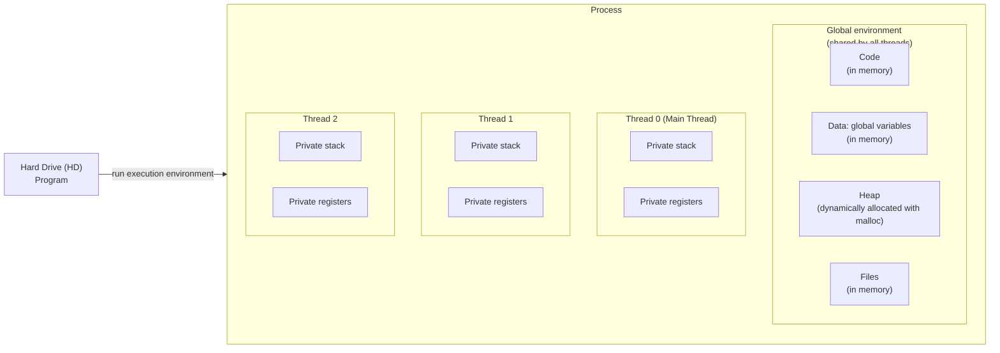
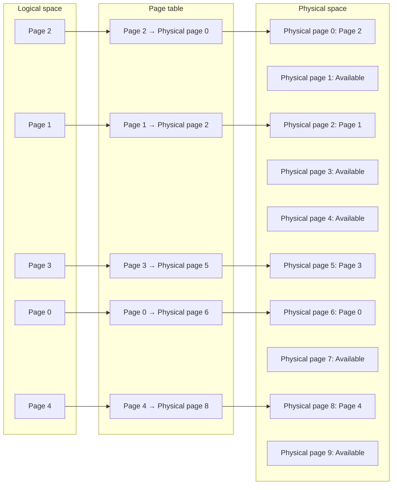
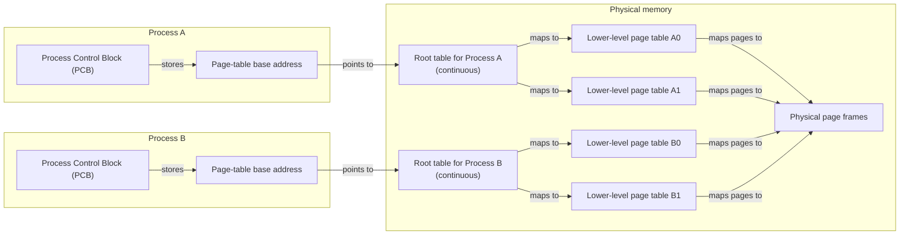

Last time: 
- Process
- Threads

Today:
- Continue on these concepts 
- Use xv6 code to try to get more concrete understanding

# Program/Process Review
The professor today writes on a digital whiteboard instead of discussing slides. 

The professor draws a diagram of a **program**. The program is inside the hard drive (HD). From the HD/Program there's an array with the label "run execution environment". The arrow goes into another entity titled **process**. Inside the process we have the following components inside and each component have also more subcomponents:
- Global environment (shared by all threads)
	- Code - in memory
	- Data (global variables) - in memory
	- Heap - malloc as allocated dynamically
	- Files - also in memory
- Thread 0 (Main Thread)
	- private stack
	- private registers
- Thread 1
	- private stack
	- private registers
- Thread 2
	- private stack
	- private registers

# Paging

Logical space = OS view - but not the physical implementation. You'd need a conversion to map these two points. 
	`logical space -> physical space`

The professor discusses a diagram about the physical space. The physical space (memory) is shown as a long, vertical rectangle of memory with a section named for process with these section then gets broken down to stack, global variables, and code. 

Requirement for physical space: 
1. Continuous in physical memory
2. Enough memory space to fit everything

Using a **paging system**, we try to break rule 1 - Continuous in physical memory. With paging we have a logical space that seems continuous but the implementation on the physical side is split into multiple sections, we then use a page table to map each logical address to a physical address. 

Example, in a 4K memory space, we need 12 bits to list all the addresses. 
	`2^12 = 4 * 2^10 = 4 * 1K` 

The professor draws a new diagram. It has two long, vertical rectangles: one for logical space and another one for physical space. The logical space memory is broken down into multiple sections: page 0, page 1, page 2, page 3, page 4. Then the physical space rectangle is broken down into multiple sections as numbered from 0 to 9 and some of the blocks have a reference to the logical page. For example, the first section in physical is for page 2; the third, for page 1; the sixth, for page 3; the seventh, for page 0; and the ninth, for page 4. Everything else is blank and available to use  for later. Between the two memory spaces, theres another rectangle title page table that maps each logical page to a physical page.  

When we run our program, we access each memory using the logical addresses as if the data was all available as a long, continuous space. However, the page table will map to the correct physical address. Does the OS do the address conversion??

For a 32-bit address, we need to break down the address into the sections: 1) page number and 2) offset. In a memory space with 4K addresses, then need the offset section to be 12-bit long, while the page number section needs to be 20-bit long. The offset pin points to the exact place within the page. A page can be huge and you might not need to address everything from the start of the page, so in this case, we use the offset to select a single address starting to count from the first address of the page. 

### Root Page Table
The page table could get very large and have the same problem from the beginning. To solve this, we can add another layer, another page table to page the page table, called the **root table**. The root table must be continuous, otherwise, we would start again with the same problem. Each process has its own root table. So, in the physical memory you can have multiple root tables for each process. You save this with a **base address** to mark the starting point of the page table. Each process has a **Process Control Block** that includes this base address. 

To calculate the "physical frame number", basically, you do: 
`base address + page number * page size (i.e. 4K)`

To calculate physical address:
`physical frame number + offset (from logical address)`

Remember key: page table is the gateway to physical space

# Stack vs Heap
The heap is shared by the process (code, global var, heap)
Each thread has its own stack. 

When thread 0 has a local variable `x = 1` and thread 1 has the variable `x = 5`, these are different. 
### Pointers
The pointer itself is in the stack `int* ptr;` so every thread has its own version. However, if we got the address from `malloc()` then the value each pointer have can be the same shared address since `malloc()` works with the heap. 

Now, in a new diagram, we have a long vertical rectangle that shows the logical space broken down in sections:
- User space (running environment)
	- Code
	- Heap
	- Lib data
	- Lib code
	- File
	- Stack 0 (for thread 0)
	- Stack 1 (for thread 1)
	- Stack 2 (for thread 2)
- Kernel space - managed by the kernel, the user cannot access
	- Page Table
	- Struck (PCB, the blueprint) 
		- Page Table Pointer
		- Region Pointer - for each different region:
			- Start address
			- End address
			- Source (like lib -> from file)
			- Permission

# PCB / TCB 
What are PCB and TCB??

In xv6, the PCB and TCB are combined as opposed to Linux. 
In xv6, we have the following structure for a PCB/TCB:
- State
	- Either RUNNING, SLEEP, RUNNABLE, ZOMBIE
- Channel pointer (`chan ptr`)
	- Object of event 
	- sleep on object 
	- wake up by same object
- Process ID `pid`
- Parent process `parent`
-   Number of the Kernel stack `kstack` 
	- K stack is different than stack ??
- Page table pointer 
- Trap frame
	- Data structure to switch from user mode to kernel mode
	- Store user register values when trap to kernel 
- Context
- Files
- Process name

