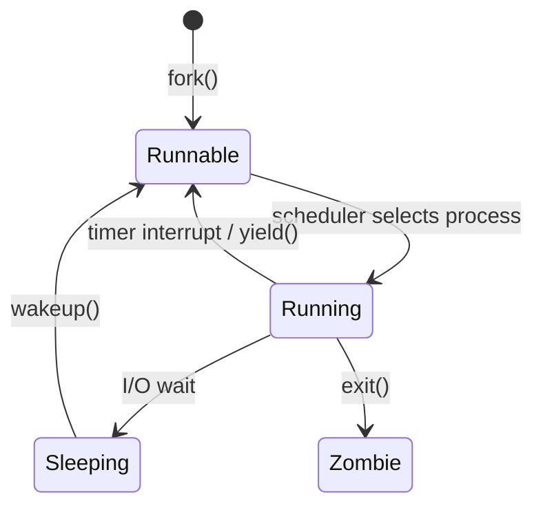

### Before
- Checked process details.
- The `init` process.
- The `fork()` function.
- Parent and child processes.
- Orphan processes.
- Zombie processes.

### Today
- Clarify process concepts: orphans and zombies.
- Work through one more example.
- Review process states.
- Introduce scheduling theory.

# `wait()` Function

- Calling `wait()` in a parent process waits for one of its **direct children** to terminate and returns that child's PID and exit status.
- If a child has already terminated, `wait()` returns immediately. Otherwise, the parent sleeps until a child changes state.

### What happens when there are multiple children?

A parent can create a child, and that child can create another child:

```text
Parent Process (first parent)
      |
Child Process (first child / second parent)
      |
Child Process (second child)
```

**Note:** When a process has multiple direct children, `wait()` returns when any one of them terminates. It does not wait for grandchildren.

To wait for a specific child (when its PID is known), use `waitpid()`.

The following example creates an orphan: the original parent waits for its first child, while the first child exits before its own child does.

```c
#include <stdio.h>
#include <sys/wait.h>

int main(void)
{
	pid_t pid;
	if ((pid = fork()) < 0) {
		printf("fork error at first parent");
	} else if (pid == 0) {
		// We're at the first child / second parent
		// Fork again
		if ((pid == fork()) < 0)
			printf("fork error at second parent");
		else if (pid > 0)
			exit(0); // Exit from first child / second parent
			
		// We're at the second child here
		// When the second parent exits, init will be the new parent
		// When this is done, init will get our status
		sleep(2);
		printf("second child, parent pid = %ld\n", (long)getppid());
		exit(0);
	}
	
	// We're at the first parent
	// pid has the id of the first child 
	// Call waitpid to wait for the first child specifically
	if (waitpid(pid, NULL, 0) != pid) { // <----------------
		printf("waitpid error");
	}
}
```

# Orphan Process

1. A parent forks and creates a child.
2. The parent exits before the child.
3. The child becomes an orphan.
4. In xv6, `init` becomes the orphan's new parent and can later collect its exit status with `wait()`.

# Zombie Process

1. A parent forks and creates a child.
2. The child exits before the parent calls `wait()`.
3. The child becomes a zombie until its parent collects its exit status.
4. `wait()` reaps the zombie and frees its process-table resources.

A zombie preserves the child's exit status so that its parent can retrieve it. If the parent exits without calling `wait()`, the child is adopted by `init` in xv6; `init` can eventually reap the child.

# Threads

Threads are execution contexts within one process. They share the process's address space and resources.

- Use `pthread_create()` to create a thread. Pass it a function pointer for the thread's start routine and an argument for that function.
- Threads do not have the same parent/child lifecycle as processes. Use `pthread_join()` when one thread needs to wait for another.
- If the initial (main) thread returns from `main()` or any thread calls `exit()`, the entire process—and all of its threads—terminates.
- `pthread_exit()` terminates only the calling thread, allowing the other threads to continue.

### Asynchronous vs. Synchronous Threads

- **Asynchronous:** Threads run concurrently; neither must wait for the other at creation time.
- **Synchronous (fork–join):** One thread waits for another to finish, usually with `pthread_join()`.

### What happens when a thread calls `fork()`?

When a thread calls `fork()`, the child receives a copy of the process address space, typically implemented efficiently with **copy-on-write**. In a multithreaded process, the child contains only a copy of the thread that called `fork()`.

`fork()` creates a new process:

- **Process:** Resource container.
  - Code and data.
  - Page table / address space.
- **Thread:** Execution context.
  - Program counter (PC), user stack, and kernel stack.

### Processes and Threads in xv6

In xv6, `struct proc` represents both a process and its single user thread of execution.

`fork()` calls `allocproc()`, which allocates and initializes a `struct proc`, including:

- Kernel stack.
- Page table.
- Context.
- Trap frame.
- State, such as `USED` or `RUNNABLE`.

#### Scheduler

- The scheduler runs on every hart. A **hart** is a RISC-V hardware execution context (similar to a logical CPU).
- xv6 scans its process table for `RUNNABLE` processes; it does not maintain a separate run queue.

### Processes and Threads in Linux

Linux represents a schedulable task with `task_struct`; it uses the same underlying task abstraction for processes and threads.

- `fork()` creates a child process with its own address space.
- Thread libraries commonly create threads with `clone()`-based mechanisms that share selected process resources, such as the address space.
- Each task has its own execution context (for example, program counter and stack).

> [!info] Key idea
> A runnable process must have at least one thread of execution. A process with no runnable or live threads cannot execute.

### `sleep()` and `wakeup()` in xv6

- `sleep(chan, lock)` changes the current process to `SLEEPING` and yields the CPU while it waits on `chan`.
- `wakeup(chan)` changes matching sleeping processes to `RUNNABLE`.
- A woken process does not run immediately; the scheduler chooses it later.
- `wait()` may sleep when none of the calling process's children has exited.

State changes occur in kernel code. System calls enter the kernel through a trap; timer interrupts and device interrupts can also lead to scheduling decisions.

Remember the kernel memory layout as a long rectangle broken into regions:

- **Kernel code**
  - Kernel trap handling.
  - System calls such as `read()`, `write()`, `wait()`, and `exit()` may change a process's state.
  - A timer interrupt can cause the current process to yield the CPU, moving from `RUNNING` to `RUNNABLE`.
- **Trampoline**
  - Handles the transition between user and kernel mode for user traps.
  - Saves registers to the trap frame and restores them before returning to user mode.
  - `usertrap()` runs in kernel code after the user-to-kernel transition.
- **Kernel data**

# Scheduler and States

> [!info] Clarification
> A trap or interrupt transfers control to the kernel. The kernel handler may change the current process's state; for example, a timer interrupt can cause `yield()`, and an I/O operation can call `sleep()`. The scheduler then selects a `RUNNABLE` process. A process moves between user mode and kernel mode as it makes system calls or handles interrupts; its address space is not copied each time.

- `Runnable (ready) → schedule → Running`
- `Running → timer (forced) or yield (voluntary) → Runnable (ready)`
- `Running → I/O wait → Sleeping`
- `Sleeping → wakeup → Runnable (ready)`
- `fork() → Runnable (ready)`
- `Running → exit() → Zombie`

The relevant events include:

- `wakeup()`
- I/O wait
- Timer interrupt
- Voluntary `yield()`



### Round-Robin Policy

A scheduling policy determines which runnable process runs next. In xv6, the scheduler scans for runnable processes in a round-robin-like order:

```text
Runnable processes:
- t0
- t1
- t2
- ...
- tn
```

# Scheduling

- At the implementation level, modern operating systems schedule **threads**, not abstract processes.
- “Process scheduling” is a conceptual abstraction rather than a separate mechanism.
- xv6 uses a simple round-robin-like policy:
  - No priorities.
  - No explicit fairness accounting.
  - No scalability-oriented per-CPU queues.
  - No cache or topology awareness.
  - No real-time guarantees.
- Modern schedulers are more complex than xv6's scheduler.

### Simple Explanation

In xv6, the general idea is:

1. Is a process runnable?
2. If yes, run it next.

In modern operating systems, the scheduler may also consider:

1. Is the task runnable?
2. What is its priority?
3. How much CPU time has it used?
4. Is it interactive?
5. Which CPU cache does it fit?
6. Does it have a real-time deadline?
7. Is another CPU idle?

### Next Time

- Continue with scheduling theory.
