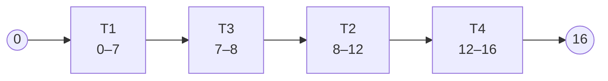
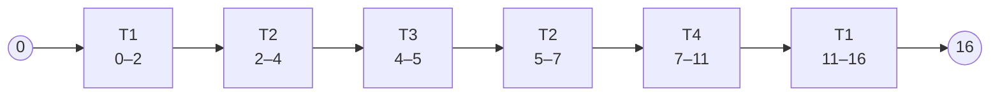
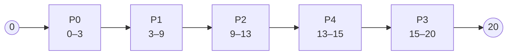

# Process Scheduling

## Continue

- **Non-preemptive:** once a process is running, it continues until it finishes, blocks, or voluntarily yields the CPU.
- **Preemptive:** a running process can be forced to pause so another process can run.

So far, we checked [[Class Week 4 - Day 1#Basic Scheduling Algorithms]]:

- **First-Come, First-Served (FCFS)**
  - Select by earliest arrival time.
  - Non-preemptive in the basic form.
  - Easy and “fair” in arrival order (no starvation).
  - Turnaround time can be high.
- **Shortest Job First (SJF)**
  - Select the process with the shortest CPU burst.
  - Non-preemptive.
  - Minimizes average waiting time when CPU-burst lengths are known.
  - Long jobs can remain at the bottom of the queue (starvation).
  - CPU-burst length is usually estimated from a process's previous CPU bursts; it cannot generally be known exactly in advance.
- **Shortest Remaining Time First (SRTF)**
  - Select by shortest remaining CPU time.
  - The preemptive version of SJF.
  - Long jobs can also starve.

*Priority is not necessarily a field stored in the process data structure. It can be an **implicit priority** derived from a scheduling policy, such as arrival time or remaining time.*

### Example for Shortest Remaining Time First

| Process | Arrival Time | Total CPU Time* |
| ------- | ------------ | --------------- |
| T1      | 0            | 7               |
| T2      | 2            | 4               |
| T3      | 4            | 1               |
| T4      | 5            | 4               |

*CPU time does not include I/O time.*

If non-preemptive (**SJF**), T1 runs to completion because it is the only task at time 0. At time 7, the scheduler selects the shortest waiting task: T3, then T2 (which arrived before T4 when their CPU times tie), then T4.

If preemptive (**SRTF**), T1 runs from 0 to 2, when T2 arrives and preempts it with 5 units remaining. T2 runs from 2 to 4; T3 then arrives with the shortest remaining time and runs to completion. T2 resumes from 5 to 7, followed by T4, then T1 finishes.

### HRRN (Highest Response Ratio Next)

`response_ratio = (waiting_time / service_time) + 1`

Equivalently: `response_ratio = (waiting_time + service_time) / service_time`.

- If waiting time is long, the response ratio increases.
- A short job has a high response ratio because its `service_time` is smaller.

| Process | Arrival Time | Service Time |
| ------- | ------------ | ------------ |
| P0      | 0            | 3            |
| P1      | 2            | 6            |
| P2      | 4            | 4            |
| P3      | 6            | 5            |
| P4      | 8            | 2            |

If non-preemptive, P0 runs from time 0 to 3. Then P1 runs from time 3 to 9. Before time 9, P2, P3, and P4 arrive in the queue. If we only check service time, P4 takes precedence, but P2 has waited the longest.

- `P2_response_ratio = (9 - 4) / 4 + 1 = 2.25`
- `P3_response_ratio = (9 - 6) / 5 + 1 = 1.60`
- `P4_response_ratio = (9 - 8) / 2 + 1 = 1.50`

P2 has the highest response ratio, so P2 runs next after P1. P2 runs from time 9 to 13. At this point, recalculate the ratios:

- `P3_response_ratio = (13 - 6) / 5 + 1 = 2.40`
- `P4_response_ratio = (13 - 8) / 2 + 1 = 3.50`

P4 has the highest response ratio, so it runs from time 13 to 15. Finally, P3 runs from time 15 to 20.

### Round Robin (RR)

All processes have the same priority and take turns using a fixed time quantum (time slice). For example, let the time slice be 2 seconds.

This policy must be preemptive.

- If the quantum is too small (`q → 0`), the system spends most of its time context-switching.
- If the quantum is extremely large (`q → ∞`), no runnable process is preempted before it finishes. Therefore, RR behaves like FCFS: processes run in arrival order until completion.

### Priority Scheduling

Assign each process a priority. The user or administrator can set an **external (static) priority**, or the system can dynamically adjust priority according to the running situation.

### Multilevel Priority

Multilevel priority is also based on an external priority set by the user or administrator. We use priority levels, for example from 0 to *n*, where 0 is the highest priority. Each level can contain multiple processes in its own ready queue.

### Multilevel Feedback Queue (MLFQ)

MLFQ is similar to multilevel priority scheduling. The smaller the number, the higher the priority. Each level has a ready queue of processes at that priority. The rules are:

1. A newly arrived or awakened process enters the highest-priority queue.
2. Schedule a process from the highest non-empty queue.
3. Use Round Robin within the same queue.
4. If a process uses its entire time allotment at a level, lower its priority.
5. To avoid starvation, periodically perform a **priority boost**.

Basically, the scheduler dynamically checks how much CPU time each process uses and adjusts its priority level.

| Priority | Maximum time at each level | Process ready queue |
| -------- | -------------------------- | ------------------- |
| 1        | `T`                        | `p1 → p2 → p3`      |
| 2        | `2T`                       |                     |
| 3        |                            |                     |
| ...      |                            |                     |
| n        | `2^(n - 1)T`               |                     |

Example: three levels with three corresponding queues:

1. First-queue maximum time: 8 ms
2. Second-queue maximum time: 16 ms
3. Third-queue maximum time: 32 ms

Say we have three jobs (A, B, and C):

- A total CPU time: 5 ms
- B total CPU time: 15 ms
- C total CPU time: 40 ms

1. A runs in the first queue and completes in 5 ms.
2. B runs for 8 ms, has 7 ms remaining, and is demoted to priority 2.
3. C runs for 8 ms, has 32 ms remaining, and is demoted to priority 2.
4. In priority 2, B runs its remaining 7 ms and completes.
5. C runs for 16 ms, has 16 ms remaining, and is demoted to priority 3.
6. C runs for its remaining 16 ms and completes.

### Types of jobs

There are two types of jobs:

- **CPU-bound:** spends most of its time running on the CPU.
- **I/O-bound:** spends much of its time waiting for I/O; interactive programs, such as text editors, are often I/O-bound.

**“Gaming the scheduler”:** a CPU-bound process can pretend to be interactive by voluntarily sleeping at 7 ms, just before an 8 ms quantum ends, to avoid demotion. A defense is to use **cumulative CPU time** at each priority level rather than resetting the allotment whenever a process yields.

### Completely Fair Scheduler (CFS)

CFS is Linux's older fair scheduler; modern Linux has been transitioning toward EEVDF. CFS tries to make CPU allocation more fair, including for important jobs that run for a long time.

CFS tracks **virtual runtime**, which weights actual CPU running time:

`virtual_runtime_increment = actual_cpu_time_increment × (1024 / weight)`

The larger the weight, the more slowly virtual runtime increases. Thus, a higher-weight process can receive more CPU time while still having a relatively low virtual runtime. The scheduler selects the runnable process with the smallest virtual runtime.

### Next Time

- Newer Linux scheduling
- Process competition and synchronization
