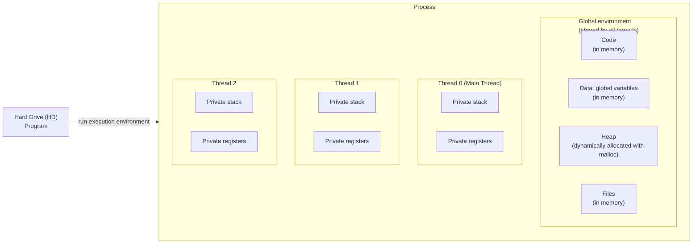

# Processes Threads and Harts

> [!info] Source priority
> The following class-note excerpts record topics the professor discussed. They are retained in detail as lecture records. Warnings distinguish corrections from the original record; pseudocode is illustrative unless explicitly stated otherwise.

**Professor materials:** Professor Slides 2-1-Hart.pdf; Professor Notes Lecture2-2.jpg; Professor Notes Lecture3-2.jpg. All listed materials are in `/Users/jossean/Documents/CSEN 283/`.

> [!note] Scope
> Harts are architectural execution contexts; operating systems may also influence cache locality even though coherence is largely hardware-managed. A process normally contains at least one thread; shared memory can also be established between processes.

---

## Lecture record: [[Class Week 2 - Day 1]] (lines 81–128)

# Process and Thread

## Process

Processes and programs are different concepts.

- **Process**
  - It is not a program.
  - It is an executing instance of a program that has entered the system.
  - It has an execution environment and resources: code, data, an address space (page table and memory), a heap, and file descriptors.
- **Program**
  - Static code: a file on disk containing instructions, data, and symbols before it is executed.

Example: Microsoft Word is a program on disk. When you double-click Word, the OS creates a process that runs in RAM; you can see it in Task Manager.

When processes exchange data, they use **IPC (interprocess communication)**, such as pipes, shared memory, sockets, or message passing.

## Threads

Every process has at least one thread. Execution is performed by a process’s thread(s), not by the process itself.

- A thread runs on a hart when scheduled by the kernel’s scheduler.

The professor discussed a C `main` function that creates three threads that increment a shared global variable named `counter`. `main` calls `pthread_create` and passes a function for the new thread to execute. It calls `pthread_join` to wait for all threads to finish.

A program has at least `thread0`, called the **main thread**. If it calls `pthread_create`, the process has the main thread and `thread1` created by that call.

### Resource hierarchy

- **Process 1**
  - Shared code
  - Shared global variables
  - Shared heap
  - **Thread 0**
    - Private registers
    - Private stack: stores call frames, local variables, and return addresses
  - **Thread 1**
    - Private registers
    - Private stack: stores call frames, local variables, and return addresses

Threads share memory only when they belong to the same process. Threads in different processes need an explicit sharing mechanism, such as shared memory or IPC.

### Summary

- **Harts** = hardware execution engines
- **Threads** = what runs on harts
- **Processes** = what own memory and shared resources

---

## Lecture record: [[Class Week 2 - Day 2]] (lines 17–68)

# Program/Process Review
The professor today writes on a digital whiteboard instead of discussing slides. 

The professor draws a diagram of a **program**. The program is inside the hard drive (HD). From the HD/Program there's an array with the label "run execution environment". The arrow goes into another entity titled **process**. Inside the process we have the following components inside and each component have also more subcomponents:
- Global environment (shared by all threads)
	- Code - in memory
	- Data (global variables) - in memory
	- Heap - malloc as allocated dynamically
	- Files - also in memory
- Thread 0 (Main Thread)
	- private stack
	- private registers
- Thread 1
	- private stack
	- private registers
- Thread 2
	- private stack
	- private registers

---

## Lecture record: [[Class Week 3 - Day 2]] (lines 98–151)

# Threads

Threads are execution contexts within one process. They share the process's address space and resources.

- Use `pthread_create()` to create a thread. Pass it a function pointer for the thread's start routine and an argument for that function.
- Threads do not have the same parent/child lifecycle as processes. Use `pthread_join()` when one thread needs to wait for another.
- If the initial (main) thread returns from `main()` or any thread calls `exit()`, the entire process—and all of its threads—terminates.
- `pthread_exit()` terminates only the calling thread, allowing the other threads to continue.

### Asynchronous vs. Synchronous Threads

- **Asynchronous:** Threads run concurrently; neither must wait for the other at creation time.
- **Synchronous (fork–join):** One thread waits for another to finish, usually with `pthread_join()`.

### What happens when a thread calls `fork()`?

When a thread calls `fork()`, the child receives a copy of the process address space, typically implemented efficiently with **copy-on-write**. In a multithreaded process, the child contains only a copy of the thread that called `fork()`.

`fork()` creates a new process:

- **Process:** Resource container.
  - Code and data.
  - Page table / address space.
- **Thread:** Execution context.
  - Program counter (PC), user stack, and kernel stack.

### Processes and Threads in xv6

In xv6, `struct proc` represents both a process and its single user thread of execution.

`fork()` calls `allocproc()`, which allocates and initializes a `struct proc`, including:

- Kernel stack.
- Page table.
- Context.
- Trap frame.
- State, such as `USED` or `RUNNABLE`.

#### Scheduler

- The scheduler runs on every hart. A **hart** is a RISC-V hardware execution context (similar to a logical CPU).
- xv6 scans its process table for `RUNNABLE` processes; it does not maintain a separate run queue.

### Processes and Threads in Linux

Linux represents a schedulable task with `task_struct`; it uses the same underlying task abstraction for processes and threads.

- `fork()` creates a child process with its own address space.
- Thread libraries commonly create threads with `clone()`-based mechanisms that share selected process resources, such as the address space.
- Each task has its own execution context (for example, program counter and stack).

> [!info] Key idea
> A runnable process must have at least one thread of execution. A process with no runnable or live threads cannot execute.
