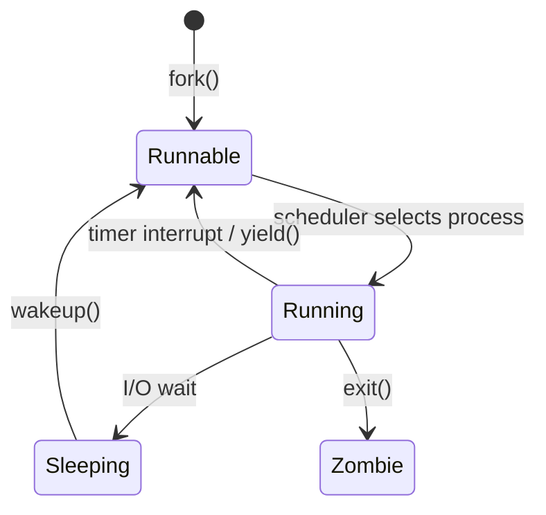

# Scheduling Mechanisms and States

> [!info] Source priority
> The following class-note excerpts record topics the professor discussed. They are retained in detail as lecture records. Warnings distinguish corrections from the original record; pseudocode is illustrative unless explicitly stated otherwise.

**Professor materials:** Professor Slides 3-2-scheduling-theory1.pdf; Professor Slides Lecture4-1-scheduling-theory1.pdf; Professor Notes Lecture3-2.jpg. All listed materials are in `/Users/jossean/Documents/CSEN 283/`.

> [!note] Terminology
> An xv6 timer interrupt can cause `yield()` and a scheduler switch, but a trap need not cause a context switch; see the trap and scheduling examples below.


---

## Lecture record: [[Class Week 2 - Day 1]] (lines 129–161)

# Scheduler

Looking at the `xv6` example, which is more complicated than RVOS:

> [!info] Clarification
> In the basic `xv6` implementation, each process has one kernel thread. It does not provide a general user-level `pthreads` interface.

~~~asm
_entry:
  # ...

  # Call start() in start.c
  call start

spin:
  j spin # Infinite loop
~~~

The `start` function prepares machine-mode settings and calls the kernel’s `main` function in `kernel/main.c`. In this setup, `main` does not return; after initialization, it enters the scheduler.

Each hart follows:

`entry.S → start.c → main.c`

The last thing `main.c` does is call `scheduler()`. The scheduler is an infinite loop that finds runnable processes and calls `swtch()`. Once `swtch()` transfers control to a process, the scheduler does not run again until that process switches back to its scheduler context.

- `swtch()` performs a context switch. In `swtch.S`, it saves the current context’s callee-saved registers to the structure passed in `a0`, then restores the next context’s registers from the structure passed in `a1`.

Each hart has its own scheduler context; there is no single central scheduler. The scheduler chooses a runnable process for the current hart.

# Next time

We will look at page tables and the process data structure: code, global variables, and page tables.

---

## Lecture record: [[Class Week 3 - Day 2]] (lines 152–246)

### The sleep and wakeup functions in xv6

- The sleep function takes a channel and a lock, changes the current process to `SLEEPING` and yields the CPU while it waits on `chan`.
- `wakeup(chan)` changes matching sleeping processes to `RUNNABLE`.
- A woken process does not run immediately; the scheduler chooses it later.
- `wait()` may sleep when none of the calling process's children has exited.

State changes occur in kernel code. System calls enter the kernel through a trap; timer interrupts and device interrupts can also lead to scheduling decisions.

Remember the kernel memory layout as a long rectangle broken into regions:

- **Kernel code**
  - Kernel trap handling.
  - System calls such as `read()`, `write()`, `wait()`, and `exit()` may change a process's state.
  - A timer interrupt can cause the current process to yield the CPU, moving from `RUNNING` to `RUNNABLE`.
- **Trampoline**
  - Handles the transition between user and kernel mode for user traps.
  - Saves registers to the trap frame and restores them before returning to user mode.
  - `usertrap()` runs in kernel code after the user-to-kernel transition.
- **Kernel data**

# Scheduler and States

> [!info] Clarification
> A trap or interrupt transfers control to the kernel. The kernel handler may change the current process's state; for example, a timer interrupt can cause `yield()`, and an I/O operation can call the sleep function. The scheduler then selects a `RUNNABLE` process. A process moves between user mode and kernel mode as it makes system calls or handles interrupts; its address space is not copied each time.

- `Runnable (ready) → schedule → Running`
- `Running → timer (forced) or yield (voluntary) → Runnable (ready)`
- `Running → I/O wait → Sleeping`
- `Sleeping → wakeup → Runnable (ready)`
- `fork() → Runnable (ready)`
- `Running → exit() → Zombie`

The relevant events include:

- `wakeup()`
- I/O wait
- Timer interrupt
- Voluntary `yield()`



### Round-Robin Policy

A scheduling policy determines which runnable process runs next. In xv6, the scheduler scans for runnable processes in a round-robin-like order:

```text
Runnable processes:
- t0
- t1
- t2
- ...
- tn
```

# Scheduling

- At the implementation level, modern operating systems schedule **threads**, not abstract processes.
- “Process scheduling” is a conceptual abstraction rather than a separate mechanism.
- xv6 uses a simple round-robin-like policy:
  - No priorities.
  - No explicit fairness accounting.
  - No scalability-oriented per-CPU queues.
  - No cache or topology awareness.
  - No real-time guarantees.
- Modern schedulers are more complex than xv6's scheduler.

### Simple Explanation

In xv6, the general idea is:

1. Is a process runnable?
2. If yes, run it next.

In modern operating systems, the scheduler may also consider:

1. Is the task runnable?
2. What is its priority?
3. How much CPU time has it used?
4. Is it interactive?
5. Which CPU cache does it fit?
6. Does it have a real-time deadline?
7. Is another CPU idle?

### Next Time

- Continue with scheduling theory.

---

## Lecture record: [[Class Week 4 - Day 1]] (lines 7–89)

### Before
- Process
- Thread
- Scheduling overview

We did not get into the details of context switching.

### Today
- More scheduling theory

# Scheduling
[[Class Week 3 - Day 2#Scheduling]]
- A conceptual abstraction, not a separate mechanism
- We need to identify whether we are switching to a new thread in a new process or to a new thread in the same process.
- Threads are the scheduled entities, not processes.
- Each thread runs on a hart.
- xv6 has one kernel thread per process. Its scheduler therefore looks like it schedules processes, because switching threads also switches processes.

Three issues in scheduling:
- **When?**
  - Selection can happen after any of these events:
    - A new task is created.
    - A blocked task is awakened.
    - A task is terminated.
    - An I/O-completion interrupt occurs and may wake a waiting task.
    - A timer interrupt occurs (the time slice expires).
- **How?**
  - How to bind work to a CPU
  - Context switch
- **Who?**
  - Which new thread to select

### What needs to happen?
- The currently running process is interrupted.
- Control switches to the kernel.
- The kernel handles the event.
- The process status changes.

Generally, there is a queue of threads that are ready to run.

Save the outgoing thread's context:
- CPU registers, including the **PC** and **SP**
- Kernel-stack pointer/context
- Scheduling state and status

> [!info] Clarification
> The kernel stack itself is not copied during a context switch; each thread's kernel stack remains in memory, and the saved stack pointer lets execution resume on it.

- If the new thread belongs to the **same** process, switch the thread's register and kernel-stack context.
- If the new thread belongs to **another** process, also switch to that process's virtual address space (for example, its page table/root-table base) and other process-specific execution state.

### PCB components
- Process ID
- CPU state/context
- Process state and scheduling information (for example, priority)
- Memory-management information, including the page-table base
- Kernel stack
- References to resources such as open files

### xv6 Scheduling
`Runnable? → Yes → Run next`

In xv6, we use a round-robin policy. But we need to determine:
- How long it should run
- Whether fairness matters
- Whether cache locality matters

### Priority and Queue
Priority is basically a number given to a process. It can be static or dynamic.
- **Static priority:** remains the same for the lifespan of the process.
- **Dynamic priority:** is recomputed every time the scheduler is invoked.

Typically, priority is a positive integer, with a lower number representing a higher priority. Another consideration is whether scheduling is preemptive or non-preemptive: whether a process can be taken off the CPU before it finishes or blocks.

- **Voluntary blocking/yielding:** the process chooses when to give up the hart.
- **Involuntary preemption:** the process is forced to give up the hart, usually when its time slice expires.
  - A time slice is a way to stop and later resume processes.

Round-robin must be preemptive. Each process runs for a fixed time quantum before the scheduler moves to the next ready process.

### Priority Queue Implementation
We usually use a binary-heap data structure to quickly pick the highest-priority process. The implementation is a design choice for the OS.
