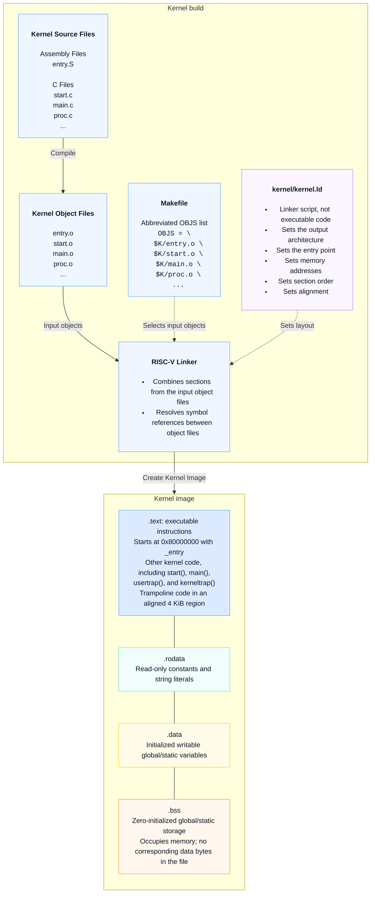
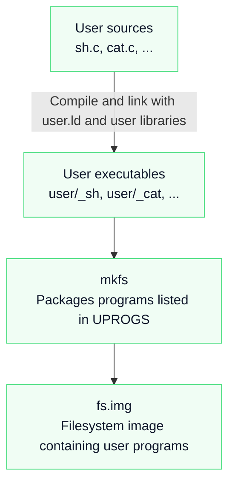

# Homework 2

## Question 4: Building the xv6 kernel image

### Kernel build and memory layout

The source, object, and Makefile nodes show four representative files to keep the diagram compact: `entry.S` (kernel entry), `start.c` (early startup), `main.c` (kernel initialization), and `proc.c` (process management and scheduling). All are in the `kernel/` directory. The `OBJS` excerpt is abbreviated; the actual Makefile links additional objects.

The memory layout runs from lower addresses at the top to higher addresses at the bottom. The lines between sections show their order, not execution flow. Alignment may add padding, and ELF metadata is omitted.

The linker combines contributions **by section**: an object's instructions contribute to `.text`, its constants to `.rodata`, and its variables to the appropriate data sections. Whole object files do not each occupy one consecutive block in the final image.

### User-program build

User programs such as `sh` and `cat` are built separately and placed in `fs.img`. They are not included in the kernel's `OBJS` list and are not linked into `kernel/kernel`.

Sources:

- [xv6 Makefile](https://raw.githubusercontent.com/mit-pdos/xv6-riscv/refs/heads/riscv/Makefile)
- [xv6 kernel linker script](https://raw.githubusercontent.com/mit-pdos/xv6-riscv/refs/heads/riscv/kernel/kernel.ld)

### Image exports for Google Docs

- [Kernel build and memory layout (PNG)](output/diagrams/hw2-kernel-build.png)
- [User-program build (PNG)](output/diagrams/hw2-user-build.png)

These images are snapshots of the Mermaid diagrams above. Re-export them after changing the diagrams.
