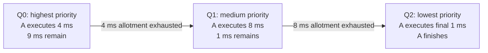

# Homework 4: Scheduling Answers and Study Guide

CSEN 283, Fall 2026

Based on [Assignment 4](/Users/jossean/Downloads/283assignment4fall2026.pdf) and the local lecture notes. Each section includes the answer and the reasoning behind it. All actual execution times below are in **milliseconds (ms)**.

## Question 1. Classical CPU Scheduling

### Given workload

| Process | Arrival time | CPU burst |
| --- | ---: | ---: |
| P1 | 0 | 8 |
| P2 | 1 | 4 |
| P3 | 2 | 2 |

Use one CPU, zero context-switch overhead, no I/O, and arrival order to break ties. For Round Robin, the quantum is 2 ms, and arrivals at a quantum boundary enter the ready queue **before** the process whose quantum just expired.

### Formulas for part (b)

For each process, let `a` = arrival time, `b` = CPU burst, `s` = first time it runs, and `c` = completion time.

| Metric                | Formula     | Meaning                                                               |
| --------------------- | ----------- | --------------------------------------------------------------------- |
| Turnaround time, T    | `T = c - a` | Total elapsed time from arrival to completion.                        |
| Ready waiting time, W | `W = T - b` | Total time ready but not executing, including waits after preemption. |
| Response time, R      | `R = s - a` | Delay before the process first receives CPU time.                     |

The waiting-time shortcut works here because there is no I/O or other blocked time. Average each metric over the three processes. Response time only counts the initial delay; it does not increase when a process is preempted later.

The Mermaid Gantt charts use milliseconds directly. Axis labels are zero-padded, so `008` means 8 ms. Each bar is one uninterrupted CPU interval. For example, `0-8` means execution from time 0 up to time 8.

### (a) FCFS timeline; (b) FCFS calculations

**Answer:** `P1: 0-8 -> P2: 8-12 -> P3: 12-14`.

```mermaid
gantt
    title FCFS - time in ms
    dateFormat x
    axisFormat %L
    tickInterval 2millisecond
    todayMarker off
    section CPU
    P1 :fcfs1, 0, 8ms
    P2 :fcfs2, 8, 4ms
    P3 :fcfs3, 12, 2ms
```



**Explanation:** First Come, First Served runs processes in arrival order. P1 begins at time 0 and finishes before P2 can run. P2 arrived before P3, so it runs next even though P3 has a shorter burst.

| Process | First start s | Completion c | Turnaround `c - a` | Waiting `T - b` | Response `s - a` |
| --- | ---: | ---: | ---: | ---: | ---: |
| P1 | 0 | 8 | `8 - 0 = 8` | `8 - 8 = 0` | `0 - 0 = 0` |
| P2 | 8 | 12 | `12 - 1 = 11` | `11 - 4 = 7` | `8 - 1 = 7` |
| P3 | 12 | 14 | `14 - 2 = 12` | `12 - 2 = 10` | `12 - 2 = 10` |

- **Average turnaround:** `(8 + 11 + 12) / 3 = 31/3 = 10.33 ms`.
- **Average ready waiting:** `(0 + 7 + 10) / 3 = 17/3 = 5.67 ms`.
- **Average response:** `(0 + 7 + 10) / 3 = 17/3 = 5.67 ms`.

Waiting and response times are equal here because each process runs to completion once it first starts.

### (a) SJF timeline; (b) SJF calculations

**Answer:** `P1: 0-8 -> P3: 8-10 -> P2: 10-14`.

```mermaid
gantt
    title Non-preemptive SJF - time in ms
    dateFormat x
    axisFormat %L
    tickInterval 2millisecond
    todayMarker off
    section CPU
    P1 :sjf1, 0, 8ms
    P3 :sjf3, 8, 2ms
    P2 :sjf2, 10, 4ms
```



**Explanation:** Non-preemptive Shortest Job First selects the shortest burst among processes that are **already ready when the CPU becomes available**. At time 0, only P1 has arrived, so it starts. P2 and P3 cannot interrupt it. At time 8, both are ready, and P3's 2 ms burst is shorter than P2's 4 ms burst.

| Process | First start s | Completion c | Turnaround `c - a` | Waiting `T - b` | Response `s - a` |
| --- | ---: | ---: | ---: | ---: | ---: |
| P1 | 0 | 8 | `8 - 0 = 8` | `8 - 8 = 0` | `0 - 0 = 0` |
| P2 | 10 | 14 | `14 - 1 = 13` | `13 - 4 = 9` | `10 - 1 = 9` |
| P3 | 8 | 10 | `10 - 2 = 8` | `8 - 2 = 6` | `8 - 2 = 6` |

- **Average turnaround:** `(8 + 13 + 8) / 3 = 29/3 = 9.67 ms`.
- **Average ready waiting:** `(0 + 9 + 6) / 3 = 5.00 ms`.
- **Average response:** `(0 + 9 + 6) / 3 = 5.00 ms`.

**Study point:** Do not sort all three processes by burst length at time 0. The scheduler cannot run P3 before P3 arrives.

### (a) SRTF timeline; (b) SRTF calculations

**Answer:** `P1: 0-1 -> P2: 1-2 -> P3: 2-4 -> P2: 4-7 -> P1: 7-14`.

```mermaid
gantt
    title SRTF - time in ms
    dateFormat x
    axisFormat %L
    tickInterval 1millisecond
    todayMarker off
    section CPU
    P1 :srtf1a, 0, 1ms
    P2 :srtf2a, 1, 1ms
    P3 :srtf3, 2, 2ms
    P2 :srtf2b, 4, 3ms
    P1 :srtf1b, 7, 7ms
```



**Explanation:** Shortest Remaining Time First is preemptive. It compares the unfinished work of all ready processes.

1. At time 0, only P1 is ready.
2. At time 1, P1 has 7 ms left. P2 arrives needing 4 ms, so P2 preempts P1.
3. At time 2, P2 has 3 ms left. P3 arrives needing 2 ms, so P3 preempts P2.
4. At time 4, P3 finishes. P2's remaining 3 ms is shorter than P1's remaining 7 ms, so P2 runs until time 7.
5. P1 then finishes its remaining 7 ms, completing at time 14.

| Process | First start s | Completion c | Turnaround `c - a` | Waiting `T - b` | Response `s - a` |
| --- | ---: | ---: | ---: | ---: | ---: |
| P1 | 0 | 14 | `14 - 0 = 14` | `14 - 8 = 6` | `0 - 0 = 0` |
| P2 | 1 | 7 | `7 - 1 = 6` | `6 - 4 = 2` | `1 - 1 = 0` |
| P3 | 2 | 4 | `4 - 2 = 2` | `2 - 2 = 0` | `2 - 2 = 0` |

- **Average turnaround:** `(14 + 6 + 2) / 3 = 22/3 = 7.33 ms`.
- **Average ready waiting:** `(6 + 2 + 0) / 3 = 8/3 = 2.67 ms`.
- **Average response:** `(0 + 0 + 0) / 3 = 0.00 ms`.

All three response times happen to be zero in this workload because each process runs immediately upon arrival. SRTF does not guarantee zero response time for every workload.

### (a) Round Robin timeline; (b) Round Robin calculations

**Answer, quantum = 2 ms:** `P1: 0-2 -> P2: 2-4 -> P3: 4-6 -> P1: 6-8 -> P2: 8-10 -> P1: 10-12 -> P1: 12-14`.

```mermaid
gantt
    title Round Robin with q = 2 ms - time in ms
    dateFormat x
    axisFormat %L
    tickInterval 2millisecond
    todayMarker off
    section CPU
    P1 :rr1a, 0, 2ms
    P2 :rr2a, 2, 2ms
    P3 :rr3, 4, 2ms
    P1 :rr1b, 6, 2ms
    P2 :rr2b, 8, 2ms
    P1 :rr1c, 10, 2ms
    P1 :rr1d, 12, 2ms
```



**Explanation:** Each running process receives up to 2 ms, then goes to the tail if it still has work. P2 arrives at time 1 while P1 runs. At time 2, P3 arrives exactly when P1's quantum expires. Following the assignment's rule, P3 enters the queue before P1 is requeued.

The queue below is shown **after arrivals and requeueing, before the next dispatch**, with its head on the left.

| Time | Ready queue | Next CPU interval |
| ---: | --- | --- |
| 0 | P1 | P1 runs 0-2; 6 ms remain. |
| 2 | P2, P3, P1 | P2 runs 2-4; 2 ms remain. |
| 4 | P3, P1, P2 | P3 runs 4-6 and finishes. |
| 6 | P1, P2 | P1 runs 6-8; 4 ms remain. |
| 8 | P2, P1 | P2 runs 8-10 and finishes. |
| 10 | P1 | P1 runs 10-12; 2 ms remain. |
| 12 | P1 | P1 runs 12-14 and finishes. |

P1 is the only ready process after time 10, so it continues across the quantum boundary at time 12. The last two bars could be merged into one 10-14 interval; separating them shows the two quanta.

| Process | First start s | Completion c | Turnaround `c - a` | Waiting `T - b` | Response `s - a` |
| --- | ---: | ---: | ---: | ---: | ---: |
| P1 | 0 | 14 | `14 - 0 = 14` | `14 - 8 = 6` | `0 - 0 = 0` |
| P2 | 2 | 10 | `10 - 1 = 9` | `9 - 4 = 5` | `2 - 1 = 1` |
| P3 | 4 | 6 | `6 - 2 = 4` | `4 - 2 = 2` | `4 - 2 = 2` |

- **Average turnaround:** `(14 + 9 + 4) / 3 = 9.00 ms`.
- **Average ready waiting:** `(6 + 5 + 2) / 3 = 13/3 = 4.33 ms`.
- **Average response:** `(0 + 1 + 2) / 3 = 1.00 ms`.

For example, P2 waits from time 1 to 2 and again from time 4 to 8: `1 + 4 = 5 ms` total waiting. Its response time is only the first 1 ms.

### (c) Smallest average turnaround time

**Answer: SRTF, with an average turnaround time of `22/3 = 7.33 ms`.**

| Algorithm | Average turnaround | Average ready waiting | Average response |
| --- | ---: | ---: | ---: |
| FCFS | 10.33 ms | 5.67 ms | 5.67 ms |
| SJF, non-preemptive | 9.67 ms | 5.00 ms | 5.00 ms |
| **SRTF** | **7.33 ms** | **2.67 ms** | **0.00 ms** |
| RR, q = 2 ms | 9.00 ms | 4.33 ms | 1.00 ms |

**Explanation:** SRTF lets the shorter arriving processes finish before the long P1. That reduces the sum of completion times enough to outweigh P1's extra delay. Non-preemptive SJF cannot interrupt P1, so its short jobs still wait until time 8.

**Calculation check:** Every schedule executes exactly `8 + 4 + 2 = 14 ms` of work and finishes at time 14. Also, average turnaround minus average waiting must equal the average CPU burst, `14/3 ms`.

**Lecture references:** [Week 4, Day 1: Basic Scheduling Algorithms](</Users/jossean/Workspace/CSEN283/Class Week 4 - Day 1.md>) and [Week 4, Day 2: SJF, SRTF, and RR](</Users/jossean/Workspace/CSEN283/Class Week 4 - Day 2.md>).

## Question 2. Priority, HRRN, and MLFQ

### (a) HRRN

**Answer: Select P2.** Its response ratio is the largest, at **3.0**.

Highest Response Ratio Next uses:

```text
Response ratio = (waiting time + estimated CPU burst) / estimated CPU burst
               = 1 + waiting time / estimated CPU burst
```

| Process | Waiting time | Estimated CPU burst | Response ratio |
| --- | ---: | ---: | ---: |
| P1 | 12 ms | 8 ms | `(12 + 8) / 8 = 2.5` |
| P2 | 6 ms | 3 ms | `(6 + 3) / 3 = 3.0` |
| P3 | 15 ms | 15 ms | `(15 + 15) / 15 = 2.0` |

**Explanation:** HRRN balances waiting with job length. P3 has waited the longest in absolute time, but P2 has waited twice its estimated service time, giving it the largest ratio. Longer waiting increases a process's ratio, while a short estimated burst also helps it score highly. HRRN normally makes this selection non-preemptively when the CPU becomes available.

The supplied waiting times are already measured at `t = 20 ms`; do not subtract them from 20 and use the result as waiting time. Response ratios have no units. Despite its name, HRRN's **response ratio** is a different quantity from Question 1's **response time**.

### (b1) A's progression through MLFQ

**Answer:** A begins in Q0, uses 4 ms, moves to Q1, uses another 8 ms, and then finishes its final 1 ms in Q2.



**Explanation:** All new processes start at the highest priority. Each level accounts for the CPU time A uses **at that level**. The 8 ms allotment at Q1 is additional to the 4 ms already used in Q0.

If A is alone and starts at time 0, its wall-clock intervals are Q0 from 0-4, Q1 from 4-12, and Q2 from 12-13. Other processes could insert waiting periods, but would not change how much CPU time A needs at each level.

### (b2) CPU time at each priority level

| Queue | Allotment at that level | CPU time A executes | CPU work remaining afterward |
| --- | --- | ---: | ---: |
| Q0 | 4 ms | **4 ms** | `13 - 4 = 9 ms` |
| Q1 | 8 ms | **8 ms** | `9 - 8 = 1 ms` |
| Q2 | Unlimited | **1 ms** | 0 ms |

**Explanation:** Q2's unlimited allotment means there is no further demotion for using CPU time there. Its **4 ms RR quantum** still limits an individual turn when other Q2 processes are waiting. A needs only 1 ms, so it finishes before using a whole quantum. An allotment and a quantum serve different purposes.

### (b3) A has 1 ms left in Q2; B arrives in Q0 needing 6 ms

| Scheduler | Executes next | Reason |
| --- | --- | --- |
| **MLFQ** | **B** | Q0 has higher priority than Q2 and preempts lower-priority work. |
| **SRTF** | **A** | A has 1 ms remaining, which is less than B's 6 ms. |

**Explanation:** MLFQ follows queue priority even when the lower-priority process is almost finished. If only A and B are ready, B first uses 4 ms in Q0, moves to Q1, and runs its remaining 2 ms before A gets its last 1 ms in Q2. Under SRTF, A finishes first and B follows.

### (b4) Why MLFQ cannot always reproduce SRTF

**Answer:** MLFQ bases its decisions on priority queues and observed CPU usage; SRTF bases its decisions on remaining CPU execution time.

**Explanation:** MLFQ does not generally know a process's future CPU needs. A process that has consumed substantial CPU time is demoted whether it has 1 ms or 100 ms left. A newly arrived process receives high priority before the scheduler knows whether it is short or long. This history-based approximation often favors short or interactive work, but cannot always identify the shortest remaining job. The A-versus-B example is a direct counterexample.

### (c) Scheduler gaming

**Answer:** Resetting CPU usage after every yield would let the process repeatedly avoid demotion. MLFQ should preserve **cumulative CPU usage at the current level** across yields and blocking.

**Explanation:** If the process runs for 3 ms and yields, a faulty scheduler resets its counter to zero. It can then run another 3 ms and yield again. Each individual turn stays below Q0's 4 ms allotment, even though total usage keeps growing. It could remain at high priority indefinitely and delay or starve lower-priority processes.

Correct accounting works as follows:

1. After its first 3 ms, the process has used 3 of Q0's 4 ms.
2. Yielding preserves that usage, leaving only 1 ms at Q0.
3. After another 1 ms of execution, its cumulative Q0 usage reaches 4 ms, and it is demoted to Q1.

The scheduler must enforce the remaining allotment, rather than grant a fresh full allotment after each return to the CPU. This is the cumulative accounting rule already specified in the assignment; ignore priority boosting as instructed by the problem.

**Lecture references:** [Week 4, Day 2: HRRN and MLFQ](</Users/jossean/Workspace/CSEN283/Class Week 4 - Day 2.md>) and [Week 5, Day 1: MLFQ gaming](</Users/jossean/Workspace/CSEN283/Class Week 5 - Day 1.md>).

## Problem 3. EDF, CFS, and EEVDF

### (a1) EDF execution order

All three tasks are ready at time 0:

| Task | CPU execution required | Absolute deadline |
| --- | ---: | ---: |
| A | 4 ms | 12 ms |
| B | 3 ms | 7 ms |
| C | 5 ms | 15 ms |

**Answer:** `B: 0-3 -> A: 3-7 -> C: 7-12`.

```mermaid
gantt
    title EDF - time in ms
    dateFormat x
    axisFormat %L
    tickInterval 1millisecond
    todayMarker off
    section CPU
    B :edfB, 0, 3ms
    A :edfA, 3, 4ms
    C :edfC, 7, 5ms
```



**Explanation:** Earliest Deadline First chooses the ready task with the earliest absolute deadline: B at 7, then A at 12, then C at 15. Although the policy is preemptive, there are no later arrivals to trigger a change in this ordering.

### (a2) Does every task meet its deadline?

**Answer: Yes.** Every completion time is at or before its deadline.

| Execution order | Task | Completion time | Deadline | Deadline minus completion | Meets deadline? |
| ---: | --- | ---: | ---: | ---: | --- |
| 1 | B | 3 ms | 7 ms | 4 ms | Yes |
| 2 | A | 7 ms | 12 ms | 5 ms | Yes |
| 3 | C | 12 ms | 15 ms | 3 ms | Yes |

**Explanation:** A deadline is the latest acceptable completion time, not a time when the task should begin. EDF finishes the entire workload at time 12, with all deadlines satisfied.

### (a3) EDF deadline versus EEVDF virtual deadline

**Answer:** EDF's deadline is an actual completion requirement on the workload's clock. EEVDF's virtual deadline is a scheduling value on a weighted virtual-time scale used to order eligible CPU requests.

**Explanation:** In this EDF problem, B must finish by the actual time `t = 7 ms`. An EEVDF virtual deadline does not promise that an application will finish by a particular real time. It helps balance CPU sharing and responsiveness, and eligibility also limits which requests may run. A task with a very early virtual deadline still needs to be eligible.

### (b1) CFS: ideal CPU percentages

**Answer:** P1 should receive **33 1/3%**, and P2 should receive **66 2/3%**.

```text
Total weight = 1024 + 2048 = 3072
P1 share = 1024 / 3072 = 1/3
P2 share = 2048 / 3072 = 2/3
```

**Explanation:** Ideal weighted fairness gives CPU time in proportion to scheduling weight. P2's weight is twice P1's, so it should receive twice as much CPU time over time. These are ideal shares for the two continuously runnable tasks; a single CPU executes only one task at a time.

### (b2) Virtual-runtime increases after each task executes for 6 ms

Use the assignment's formula:

```text
Delta vruntime = Delta actual CPU time * (1024 / weight)
```

| Task | Weight | Actual CPU time used | Increase in virtual runtime |
| --- | ---: | ---: | ---: |
| P1 | 1024 | 6 ms | `6 * 1024/1024 = 6` virtual ms |
| P2 | 2048 | 6 ms | `6 * 1024/2048 = 3` virtual ms |

**Explanation:** P2 accumulates virtual runtime at half P1's rate. These are **increases**, not absolute virtual-runtime values; the initial values were not supplied. Each task using 6 ms means 12 ms of total CPU execution on a single core.

### (b3) Why equal virtual-runtime increments can represent fairness

**Answer:** Virtual runtime measures CPU service relative to a task's weight. Equal increments mean equal progress after adjusting for entitlement, even when actual CPU times differ.

For example:

| Task | Actual CPU time | Virtual-runtime increase |
| --- | ---: | ---: |
| P1, weight 1024 | 3 ms | `3 * 1024/1024 = 3` |
| P2, weight 2048 | 6 ms | `6 * 1024/2048 = 3` |

**Explanation:** Across these 9 ms, P1 receives one-third of CPU time and P2 receives two-thirds, exactly matching their weights. Both accumulate the same virtual-runtime increase. In the lecture's CFS model, selecting the runnable task with the smallest virtual runtime tends to keep tasks near the same virtual progress and produces the intended weighted shares. Equal real CPU time would give P2 less than its weighted entitlement.

### (c1) EEVDF's two main goals

**Answer:**

1. **Fairness:** Give runnable tasks CPU service according to their scheduling weights.
2. **Responsiveness:** Reduce scheduling delay for latency-sensitive work, including tasks requesting short CPU slices.

**Explanation:** Equal-weight tasks should receive equal service over time, while short requests can receive prompt attention within the fairness constraint. The lecture presents EEVDF as combining eligibility based on fairness with ordering based on virtual deadlines. The [Linux EEVDF documentation](https://docs.kernel.org/scheduler/sched-eevdf.html) confirms these roles.

### (c2) Roles of lag and virtual deadline

**Answer:** Lag determines **which tasks are eligible**. Virtual deadline determines **which eligible task runs next**.

Using the lecture's conceptual definition:

```text
lag = ideal CPU service owed so far - actual CPU service received so far
```

| Lag | Meaning | Eligible? |
| --- | --- | --- |
| Positive | The task has received less than its fair share. | Yes |
| Zero | The task is exactly at its fair share. | Yes |
| Negative | The task has received more than its fair share. | No |

For a newly issued CPU request, a convenient virtual-deadline formula in the same normalization used in part (b) is:

```text
virtual deadline = request's starting vruntime + requested slice * (1024 / weight)
```

**Explanation:** First filter for ready tasks with nonnegative lag, then choose the earliest virtual deadline among them. Shorter requested slices tend to produce earlier deadlines. The deadline is associated with the request; the formula does not mean repeatedly adding the whole slice to the task's advancing vruntime while that same request runs.

The Week 5 notes write the slice contribution as `slice / weight`; this is the same weighting idea with the normalization constant left implicit. Use one virtual-time scale consistently. The assignment explicitly uses 1024 as the reference weight for virtual runtime.

### (c3) A requests a shorter slice than B; weights are equal and both are eligible

**Answer:** **A is more likely to run first**, provided its virtual deadline is earlier. Equal starting virtual runtimes for their requests are a sufficient additional condition. Equal weights and eligibility alone do not specify the deadline ordering.

With common weight `w`, request-start virtual runtimes `vA` and `vB`, and slices `qA < qB`:

```text
DA = vA + qA * (1024 / w)
DB = vB + qB * (1024 / w)

A runs before B when DA < DB.
Equivalently: vA - vB < (qB - qA) * (1024 / w).
```

**Explanation:** If `vA = vB`, A's smaller slice gives it a smaller deadline. For example, with weight 1024 and both requests starting at virtual time 10, A's 2 ms slice gives deadline 12, while B's 6 ms slice gives deadline 16. A is selected before B. If the starting virtual runtimes differ enough, a shorter slice alone need not give A the earlier deadline. If deadlines tie, a tie-breaking rule is needed.

This compares A with B; another eligible task with an even earlier deadline could run before either one. The deadline comparison follows from the lecture's formula and the [documented EEVDF selection rule](https://docs.kernel.org/scheduler/sched-eevdf.html).

**Lecture references:** [Week 5, Day 1: CFS, EEVDF, and EDF](</Users/jossean/Workspace/CSEN283/Class Week 5 - Day 1.md>) and [Week 4, Day 2: CFS introduction](</Users/jossean/Workspace/CSEN283/Class Week 4 - Day 2.md>). For an additional explanation of CFS's ideal CPU model and virtual-runtime selection, see the [Linux CFS documentation](https://docs.kernel.org/scheduler/sched-design-CFS.html).
