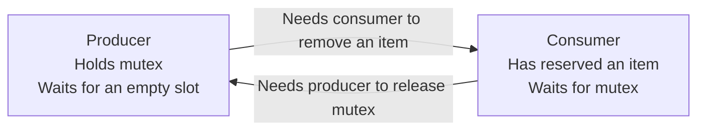

# Homework 5: Synchronization Answers and Study Guide

CSEN 283, Fall 2026

Based on [Assignment 5](/Users/jossean/Downloads/283assignment5fall2026.pdf) and the local lecture notes. This standalone guide includes the assignment questions, original code and given data, final answers, and explanations for studying. Original problem statements are labeled separately from the solutions; the PDF and lecture links are optional references. Semaphore and mutex examples are pseudocode: assume properly initialized synchronization objects and atomic `wait`/`signal` or lock/unlock operations.

## Problem 1. Spinlock vs. Mutex

### Original problem setup

Consider a multicore operating system in which multiple threads may access shared kernel data structures.

### (a) What happens when the lock is already held?

**Question:** Explain the main difference between a spinlock and a mutex when the lock is already held by another thread.

**Answer:** A spinlock makes the waiting thread **busy-wait**. A blocking mutex puts the waiting thread **to sleep**, allowing the CPU to execute other work.

| Lock | Waiting behavior | Main cost while contended | Typical use |
| --- | --- | --- | --- |
| Spinlock | Repeatedly tries to acquire the lock. | Consumes CPU cycles while waiting. | Very short, nonblocking kernel critical sections. |
| Blocking mutex | Blocks until it can acquire the lock. | Blocking, scheduling, and wakeup overhead. | Longer critical sections or work that may sleep. |

**Explanation:** Both provide mutual exclusion when all competing threads use the same lock. Their difference is how a thread waits. A spinning thread remains executing; a blocked thread is not runnable until awakened. Some practical mutex implementations briefly spin before blocking, but the assignment uses the basic distinction above.

### (b) A critical section takes approximately 10 microseconds

**Question:** Suppose a thread needs to protect a critical section that takes approximately 10 microseconds to execute. Would you prefer a spinlock or a mutex? Explain your reasoning.

**Answer:** Prefer a **spinlock**, assuming the section never blocks and contention is low enough that the expected wait is short.

**Explanation:** On a multicore system, the holder can finish on another CPU while a waiting thread spins. For a short section, avoiding a block, context switch, and wakeup can be worthwhile. Here, `10 microseconds = 0.01 milliseconds`.

This is a conditional choice, not a universal 10-microsecond cutoff. Heavy contention, a delayed lock holder, or inexpensive blocking can favor a mutex. The relevant comparison is **expected spinning cost versus blocking and wakeup cost**, not just the section's nominal execution time.

### (c) The critical section may block for disk I/O

**Question:** Suppose a critical section contains an operation that may block while waiting for disk I/O. Would a spinlock be appropriate? Why or why not?

**Answer: No. A spinlock should not be held across an operation that may block.** Use a sleeping lock in a context where sleeping is permitted, or restructure the code to release the spinlock safely before waiting.

**Explanation:** Disk completion may take much longer than a short critical section. Other CPUs would waste time spinning while the holder cannot execute. Worse, completion or wakeup code might need the same lock, creating a deadlock. In xv6, sleeping while retaining an ordinary spinlock also violates the scheduler's locking rules.

### (d) Why xv6 disables local interrupts during spinlock acquisition

**Question:** In xv6, acquiring a spinlock also disables interrupts on the local CPU. Explain why this is necessary even on a multicore system.

**Answer:** It prevents an interrupt handler on the same CPU from trying to acquire a lock held by the code it interrupted.

**Explanation:** Without this protection, the handler could wait for the interrupted code to release the lock, but that code cannot resume until the handler returns. This is self-deadlock; xv6's recursive-acquisition check can detect the error and panic. Disabling interrupts before acquisition prevents this situation. The atomic lock still excludes other CPUs; local interrupt masking does not stop them. xv6 restores the previous interrupt state after the outermost matching release. See [xv6 spinlock implementation](https://raw.githubusercontent.com/mit-pdos/xv6-riscv/riscv/kernel/spinlock.c).

**Lecture reference:** [Week 5, Day 2: Hardware Solutions and Spin Locks](</Users/jossean/Workspace/CSEN283/Class Week 5 - Day 2.md>).

## Problem 2. Find the Synchronization Bug

### Original problem setup

Consider the following shared variable and two threads:

```c
int counter = 0;
mutex_t lock;

void thread_A() {
    mutex_lock(&lock);
    counter++;
    mutex_unlock(&lock);
}

void thread_B() {
    counter++;
}
```


The original program initializes `counter` to 0. Thread A locks `lock` around `counter++`, but thread B increments the same counter without locking.

### (a) Is the original program race-free?

**Question:** Is the program free from race conditions? Explain.

**Answer: No.** Thread B can access `counter` while A holds the mutex, because B never acquires that mutex.

**Explanation:** A lock only coordinates participants that follow its protocol. An ordinary `counter++` is a read-modify-write operation, not a guaranteed atomic increment. A possible conceptual interleaving is:

| Step | Thread A | Thread B | Shared counter |
| ---: | --- | --- | ---: |
| 1 | Acquires `lock`; reads 0. | | 0 |
| 2 | | Reads 0 without locking. | 0 |
| 3 | Computes and writes 1. | | 1 |
| 4 | | Computes and writes 1. | 1 |
| 5 | Releases `lock`. | | 1 |

Both increments occurred, but one update was lost: the intended final result is 2. In actual C/C++, an unsynchronized data race on an ordinary variable is undefined behavior; this table illustrates the bug rather than limiting its possible outcomes.

### (b) Both threads use the same mutex

**Question:** Suppose `thread_B` also uses `mutex_lock(&lock)` and `mutex_unlock(&lock)` around `counter++`. Is the race condition eliminated?

**Answer: Yes.** The race between these two increments is eliminated if both use the **same initialized mutex** around the entire operation.

```c
void thread_A() {
    mutex_lock(&lock);
    counter++;
    mutex_unlock(&lock);
}

void thread_B() {
    mutex_lock(&lock);
    counter++;
    mutex_unlock(&lock);
}
```

**Explanation:** Only one thread can execute its increment at a time. The second sees the first thread's completed update. If each thread runs once and both finish, `counter` is **2**. Any additional concurrent accesses to `counter` must follow the same synchronization protocol.

### (c) A uses a spinlock; B uses a mutex

**Question:** Suppose `thread_A` uses a spinlock while `thread_B` uses a mutex to protect the same variable. Does this guarantee mutual exclusion? Explain.

**Answer: No. Separate locks do not guarantee mutual exclusion for the same variable.**

**Explanation:** A can acquire its spinlock while B simultaneously acquires its mutex. Neither lock records that the other is held, so both threads can enter their critical sections. The solution is a common lock and protocol, not simply placing some kind of lock around each access. Separate mutexes would have the same problem.

### (d) Disable interrupts on one CPU

**Question:** Can disabling interrupts on one CPU guarantee mutual exclusion for this shared variable in a multicore system? Explain.

**Answer: No.** Disabling local interrupts cannot stop another CPU from updating the shared variable.

**Explanation:** Interrupt masking controls execution on the current CPU. A thread on a different CPU continues independently. Multicore mutual exclusion needs a shared synchronization mechanism, such as a common lock implemented with atomic operations.

**Study point:** A critical section is protected only if **every competing access** obeys the same synchronization rules.

## Problem 3. Semaphore Execution Trace

### Original problem setup

Consider a counting semaphore `S`, initialized to **2**. Four threads execute the following operations in the specified order:

| Step | Thread | Operation |
| ---: | --- | --- |
| 1 | T1 | `wait(S)` |
| 2 | T2 | `wait(S)` |
| 3 | T3 | `wait(S)` |
| 4 | T1 | `signal(S)` |
| 5 | T4 | `wait(S)` |
| 6 | T2 | `signal(S)` |

Assume that a `signal(S)` operation wakes the longest-waiting thread, if any. A newly awakened thread obtains the released permit, and the specified event order is followed.

### Solution walkthrough: complete trace

`S` initially provides **2 permits**. Each `signal(S)` hands a permit to the longest-waiting thread, if one exists. The awakened thread obtains that permit immediately under the assignment's rule.

The table uses **available permits**, which never become negative. Permit holders are listed after each event; the waiting queue's head is on the left.

| Step | Thread | Operation | Result | Available permits | Permit holders | Waiting queue |
| ---: | --- | --- | --- | ---: | --- | --- |
| Initial | | | Two permits are available. | 2 | None | Empty |
| 1 | T1 | `wait(S)` | T1 obtains one permit. | 1 | T1 | Empty |
| 2 | T2 | `wait(S)` | T2 obtains the other permit. | 0 | T1, T2 | Empty |
| 3 | T3 | `wait(S)` | T3 blocks. | 0 | T1, T2 | T3 |
| 4 | T1 | `signal(S)` | T1 releases; T3 wakes and obtains the permit. | 0 | T2, T3 | Empty |
| 5 | T4 | `wait(S)` | T4 blocks. | 0 | T2, T3 | T4 |
| 6 | T2 | `signal(S)` | T2 releases; T4 wakes and obtains the permit. | 0 | T3, T4 | Empty |

### (a) Which thread blocks at Step 3?

**Question:** Which thread blocks at Step 3?

**Answer: T3.**

**Explanation:** T1 and T2 already hold both permits. T3 must wait for a permit to be released.

### (b) What happens to T3 at Step 4?

**Question:** What happens to T3 at Step 4?

**Answer:** T3 is awakened and obtains the permit released by T1.

**Explanation:** T3 is the only waiting thread, so it is also the longest-waiting thread. Its pending `wait(S)` succeeds; it does not need to call `wait(S)` again. Awakening makes it eligible to run, but does not necessarily mean it immediately executes on a CPU.

### (c) Does T4 block at Step 5?

**Question:** Does T4 block at Step 5?

**Answer: Yes.**

**Explanation:** T1's released permit has already been assigned to T3. T2 and T3 now hold both permits, leaving none for T4. T4 cannot take the permit just because T3 might not have resumed execution yet.

### (d) Which threads hold permits after Step 6?

**Question:** Which threads hold semaphore permits after Step 6?

**Answer: T3 and T4.**

**Explanation:** T3 keeps the permit obtained at Step 4. T2's release at Step 6 gives its permit to T4. No threads remain blocked, and no permits are free.

### (e) Counting semaphore vs. binary semaphore

**Question:** Explain how a counting semaphore differs from a binary semaphore.

**Answer:** A counting semaphore can represent multiple available permits; a binary semaphore has a logical availability value of **0 or 1**.

**Explanation:** A counting semaphore initialized to `k` can admit up to `k` concurrent resource users when each user takes one permit and later returns it. A binary semaphore initialized to 1 can enforce one-at-a-time access; initialized to 0, it can make one thread wait for another thread's signal. Unlike a typical mutex, a semaphore does not require the signaling thread to be its owner.

**Connection to the lecture's implementation:** The notes use a signed internal counter that becomes negative to count blocked threads. In that representation, the values after Steps 1-6 are `1, 0, -1, 0, -1, 0`. A value of `-1` means one blocked thread, not a negative number of physically available resources. This is the same trace expressed with a different bookkeeping convention.

**Lecture reference:** [Week 7, Day 1: Semaphores](</Users/jossean/Workspace/CSEN283/Class Week 7 - Day 1.md>).

## Problem 4. Producer-Consumer: Identify the Deadlock

### Original problem setup

A bounded buffer has capacity `N`. The following semaphores are initialized, and the producer and consumer execute the code below:

```c
semaphore empty = N;
semaphore full = 0;
semaphore mutex = 1;

// Original producer code to analyze.
void producer() {
    while (true) {
        item = produce_item();
        wait(mutex);
        wait(empty);
        insert_item(item);
        signal(full);
        signal(mutex);
    }
}

// Original consumer code.
void consumer() {
    while (true) {
        wait(full);
        wait(mutex);
        item = remove_item();
        signal(mutex);
        signal(empty);
        consume_item(item);
    }
}
```

### Explanation of the given semaphores

| Semaphore | Initial value | Purpose |
| --- | ---: | --- |
| `empty` | `N` | Counts available buffer slots. |
| `full` | 0 | Counts available items. |
| `mutex` | 1 | Protects buffer updates. |

Assume `N > 0`. In the faulty producer, `wait(mutex)` occurs **before** `wait(empty)`.

### (a) What is the synchronization problem?

**Question:** Identify the synchronization problem in the producer code.

**Answer:** The producer can block waiting for an empty slot **while holding the buffer mutex**, causing deadlock.

**Explanation:** When the buffer is full, only a consumer can remove an item and create a free slot. But the consumer needs `mutex` to remove that item. The blocked producer holds precisely the lock the consumer needs to make progress.

### (b) Execution sequence that causes deadlock

**Question:** Describe an execution sequence that causes deadlock when the buffer becomes full.

**Answer:** Fill the buffer, then let the producer acquire `mutex` and wait on `empty` before the consumer acquires `mutex`.

| Step | Event | Consequence |
| ---: | --- | --- |
| 1 | The producer fills all `N` slots and finishes those iterations. | `empty = 0`, `full = N`, and `mutex` is free. |
| 2 | The producer prepares another item and executes `wait(mutex)`. | Producer holds the buffer lock. |
| 3 | Producer executes `wait(empty)`. | No slot is available, so producer blocks while retaining `mutex`. |
| 4 | Consumer executes `wait(full)`. | It successfully reserves an available item. |
| 5 | Consumer executes `wait(mutex)`. | It blocks because producer still holds `mutex`. |

**Explanation:** The producer needs the consumer to remove an item and signal `empty`. The consumer needs the producer to release `mutex`. Neither can reach its signal operation.



### (c) Corrected producer

**Question:** Modify the producer code to eliminate the problem.

**Answer:** Wait for an empty slot **before** acquiring `mutex`.

```c
void producer() {
    while (true) {
        item = produce_item();

        wait(empty);          // Reserve a slot; may block without mutex.
        wait(mutex);          // Protect the buffer update.

        insert_item(item);

        signal(mutex);        // Finish the protected update.
        signal(full);         // Publish one available item.
    }
}
```

**Explanation:** A producer blocked on a full buffer no longer prevents a consumer from entering the buffer. The consumer can remove an item and signal `empty`, allowing the producer to proceed. The assignment's consumer already uses the corresponding safe order: `wait(full)` followed by `wait(mutex)`.

The essential fix is swapping the producer's two `wait` calls. Signaling `full` after insertion but before releasing `mutex`, as in the original, is not itself the deadlock bug; the awakened consumer would simply wait for the producer to unlock.

### (d) Why does semaphore order matter?

**Question:** Explain why the order of semaphore operations matters.

**Answer:** The order determines which resources a thread retains while it waits for others. A bad order can create circular waiting.

**Explanation:** First reserve the condition needed to proceed, then lock the buffer briefly to modify it:

| Operation | Correct acquisition order |
| --- | --- |
| Produce | `wait(empty)` then `wait(mutex)` |
| Consume | `wait(full)` then `wait(mutex)` |

Do not wait for space or items while retaining the lock needed by the thread that creates them. The two counting semaphores prevent overflow and underflow; `mutex` prevents simultaneous conflicting buffer updates. These are separate responsibilities.

**Lecture references:** [Week 7, Day 1: Producer-Consumer](</Users/jossean/Workspace/CSEN283/Class Week 7 - Day 1.md>) and [Week 7, Day 2: Semaphore Order](</Users/jossean/Workspace/CSEN283/Class Week 7 - Day 2.md>).

## Problem 5. Reader-Writer Problem: Writer Starvation

### Original problem setup

Consider the reader-preference solution to the reader-writer problem:

```c
semaphore mutex = 1;
semaphore wrt = 1;
int read_count = 0;

void reader() {
    wait(mutex);
    read_count++;
    if (read_count == 1)
        wait(wrt);
    signal(mutex);

    read_data();

    wait(mutex);
    read_count--;
    if (read_count == 0)
        signal(wrt);
    signal(mutex);
}

void writer() {
    wait(wrt);
    write_data();
    signal(wrt);
}
```

In the supplied solution, `mutex` protects `read_count`, and `wrt` excludes writers from other writers and from active reader groups. Both semaphores start at 1; `read_count` starts at 0.

### (a) Why can multiple readers access the resource simultaneously?

**Question:** Explain why multiple readers can access the shared resource simultaneously.

**Answer:** Only the first reader acquires `wrt`; later readers join the active reader group without acquiring it individually.

**Explanation:** Each reader briefly holds `mutex` while incrementing `read_count`. The first reader changes the count from 0 to 1 and waits on `wrt`. Once it acquires `wrt` and releases `mutex`, other readers can increment the count and enter. Readers release `mutex` **before** `read_data()`, so the reading itself is not serialized.

### (b) Why cannot a writer access the resource while readers are active?

**Question:** Explain why a writer cannot access the resource while readers are active.

**Answer:** The reader group retains `wrt` until the last reader leaves.

**Explanation:** Every writer must successfully execute `wait(wrt)` before writing. The first reader acquires this semaphore on behalf of the group, and the last reader releases it when `read_count` becomes 0. Thus, a writer waits until the group has finished. While a writer holds `wrt`, the first arriving reader blocks before reading, which also keeps later readers behind `mutex`.

### (c) Can a writer starve?

**Question:** Can a writer experience starvation? Describe a possible execution sequence.

**Answer: Yes.** A continual stream of overlapping readers can keep `read_count` above zero indefinitely.

| Step | Event | Active reader count | Writer W |
| ---: | --- | ---: | --- |
| 1 | R1 enters and acquires `wrt`. | 1 | Not yet waiting. |
| 2 | W executes `wait(wrt)`. | 1 | Blocks. |
| 3 | R2 enters before R1 leaves. | 2 | Still blocked. |
| 4 | R1 leaves. | 1 | Still blocked. |
| 5 | R3 enters before R2 leaves. | 2 | Still blocked. |
| 6 | R2 leaves. | 1 | Still blocked. |
| Repeat | Another reader enters before the last active reader leaves. | Always at least 1 | May wait forever. |

**Explanation:** New readers only wait on `wrt` when they are the first reader. Joining an existing group lets them bypass the waiting writer, so `wrt` might never be released. Even FIFO ordering on `wrt` alone cannot help if readers never release it.

**Study point:** This is **starvation**, not deadlock. Readers continue making progress while the writer is indefinitely denied access.

### (d) Modification that prevents writer starvation

**Question:** Propose a modification to prevent writer starvation. You may use additional semaphores and pseudocode.

**Answer:** Add a **FIFO admission semaphore**, `service_queue`, that both readers and writers must pass through. A waiting writer then prevents later readers from continually joining ahead of it.

**Assumptions:** `service_queue` serves blocked threads in FIFO order without barging. Threads eventually get scheduled, and each admitted read/write operation finishes. Ordinary semaphores do not automatically guarantee FIFO behavior; it is an explicit requirement of this solution.

```c
semaphore service_queue = 1;  // FIFO admission gate, no barging.
semaphore mutex = 1;          // Protects read_count.
semaphore wrt = 1;            // Resource access.
int read_count = 0;

void reader() {
    wait(service_queue);
    wait(mutex);

    read_count++;
    if (read_count == 1)
        wait(wrt);

    signal(mutex);
    signal(service_queue);   // Let the next arrival seek admission.

    read_data();             // Readers may still overlap here.

    wait(mutex);
    read_count--;
    if (read_count == 0)
        signal(wrt);
    signal(mutex);
}

void writer() {
    wait(service_queue);
    wait(wrt);               // Retain the gate until resource acquired.
    signal(service_queue);

    write_data();

    signal(wrt);
}
```

**Explanation:** When a writer reaches the front, it holds `service_queue` while waiting for existing readers to leave. Later readers cannot enter the group. Existing readers do not need the admission gate to exit, so they can finish and the last one releases `wrt`. The writer then acquires the resource and writes.

FIFO admission ensures that later arrivals cannot repeatedly overtake a queued writer. Readers admitted consecutively can still read concurrently because they release the gate before `read_data()`. This modification provides fair admission rather than permanently favoring either readers or writers.

**Why holding the gate while waiting is safe here:** Unlike the broken buffer solution, existing resource users do not need that gate to release `wrt`. If the first reader waits on `wrt` while holding `mutex`, the current holder is a writer, whose exit does not need `mutex`.

**Lecture reference:** [Week 7, Day 2: Reader-Writer Problem](</Users/jossean/Workspace/CSEN283/Class Week 7 - Day 2.md>). The FIFO gate above is a complete alternative to reader preference.

## Problem 6. Synchronization in the xv6 Kernel

### Original problem setup

In xv6, multiple CPUs may execute kernel code simultaneously. The kernel uses spinlocks to protect shared data structures, such as process-related state.

Consider a shared linked list of kernel objects. Two CPU cores may simultaneously execute the following `insert()` function:

```c
struct node *head;
struct spinlock list_lock;

void insert(struct node *new_node) {
    new_node->next = head;
    head = new_node;
}
```

### (a) How concurrent insertion causes a race

**Question:** Explain how concurrent execution of `insert()` can cause a race condition.

**Answer:** Both CPUs can read the same old `head` and then overwrite each other's updates, losing a node from the reachable list.

Let `H` be the original head, and let CPU 0 insert node A while CPU 1 inserts a distinct node B.

| Step | CPU 0 | CPU 1 | Shared head |
| ---: | --- | --- | --- |
| 1 | `A->next = head` sets A's next pointer to H. | | H |
| 2 | | `B->next = head` sets B's next pointer to H. | H |
| 3 | `head = A` | | A |
| 4 | | `head = B` | B |

**Explanation:** The reachable list is now `B -> H -> ...`. A still exists in memory, but it is absent from the list reachable from `head`. Both insertions need to be indivisible relative to one another. Even if each pointer load/store is atomic, the two-statement insertion as a whole is not.

### (b) Corrected insertion using acquire() and release()

**Question:** Modify `insert()` using xv6's `acquire()` and `release()` functions.

**Answer:** Acquire `list_lock` before reading `head`, and release it after updating `head`.

```c
struct node *head;
struct spinlock list_lock;

// Run once during initialization, before concurrent list access.
void list_init(void) {
    head = 0;
    initlock(&list_lock, "list_lock");
}

void insert(struct node *new_node) {
    acquire(&list_lock);

    new_node->next = head;
    head = new_node;

    release(&list_lock);
}
```

**Explanation:** The second CPU must wait until the first completes both pointer updates. If A inserts first, B observes A as the new head and produces `B -> A -> H -> ...`. If B inserts first, the result is `A -> B -> H -> ...`. Both valid orders preserve both nodes.

Locking only `head = new_node` is insufficient: the earlier read of `head` could already be stale. All conflicting list operations must follow the same locking protocol, including traversal when concurrent modification or deletion would make it unsafe. Assume each `new_node` is valid and is not already linked into the list.

### (c) Why local interrupt disabling is insufficient

**Question:** Why is disabling interrupts on only the local CPU insufficient to protect this linked list?

**Answer:** The other CPU can still execute `insert()` concurrently.

**Explanation:** Interrupts disabled on CPU 0 do not suspend CPU 1. xv6 combines local interrupt masking with an atomic shared-lock acquisition: the first handles local interruption, while the second coordinates CPUs. Acquire/release memory ordering also makes protected updates visible in the required order. See [xv6 spinlock implementation](https://raw.githubusercontent.com/mit-pdos/xv6-riscv/riscv/kernel/spinlock.c).

### (d) Why sleeping while retaining list_lock is incorrect

**Question:** Suppose a kernel function acquires `list_lock` and then calls `sleep()` without releasing it. Explain why this is incorrect in xv6.

**Answer:** A process must not enter the sleeping state while still holding `list_lock`. The lock would remain unavailable while its holder cannot execute, and xv6 rejects scheduling with extra spinlocks held.

**Explanation:** A thread needed to satisfy the sleep condition might itself need this lock, causing deadlock. xv6's `sched()` expects only `p->lock`; an extra retained spinlock normally triggers `panic("sched locks")`.

The required rule concerns the lock held **during sleep**. In versions with `sleep(chan, &list_lock)`, that call safely releases the supplied lock before sleeping and reacquires it before returning. The upstream version checked here instead uses `sleep_prepare(chan)`, then an explicit lock release, `sleep()`, and reacquisition. Use the API in the course's xv6 version. Both protocols coordinate wakeup registration with releasing the condition lock; simply unlocking and then sleeping can miss a wakeup. See [xv6 process and scheduling implementation](https://raw.githubusercontent.com/mit-pdos/xv6-riscv/riscv/kernel/proc.c).

**Study point:** Protect the condition check, arrange the sleep transition safely, and recheck the condition after waking. Never retain an unrelated spinlock across a blocking operation.

## Quick Review

| Concept | What to remember |
| --- | --- |
| Spinlock | Busy-wait; use for short, nonblocking critical sections. |
| Blocking mutex | Sleep while waiting; suitable when waiting may be long. |
| Shared lock protocol | Every competing access must participate. |
| Local interrupt masking | Controls only the current CPU. |
| Counting semaphore | Tracks multiple permits; a released permit may go directly to a waiter. |
| Producer-consumer order | Reserve space/item before locking the buffer. |
| Deadlock | Threads cannot progress because of circular dependencies. |
| Starvation | One thread waits indefinitely while others keep progressing. |
| Reader preference | New readers can extend a group indefinitely and starve writers. |
| Fair admission | A FIFO gate prevents later arrivals from repeatedly bypassing a writer. |
| xv6 sleep | Ordinary spinlocks must be released through the correct sleep protocol. |
