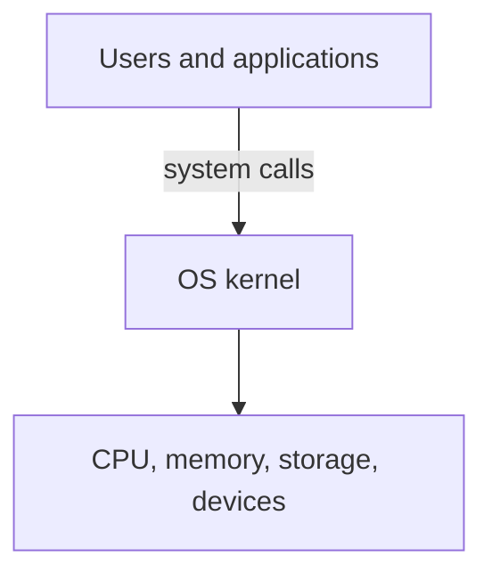

# Operating System Foundations

An **operating system** provides abstractions and controlled access to hardware while sharing CPU time, memory, and devices among programs. The **kernel** is its privileged core.

## Why an OS?

- **Convenience:** files, processes, and memory hide device-specific details.
- **Resource management:** schedule runnable work; allocate and reclaim memory and devices.
- **Protection:** isolate processes and restrict privileged operations.
- **Coordination:** respond to events and let processes exchange data.

RAM is working memory; persistent storage retains data across power loss. A **program** is stored code; a **process** is a running program and its execution environment.

## Privilege and kernel organization

| Concept | Meaning |
| --- | --- |
| User mode | Applications have restricted access to hardware and protected memory. |
| Kernel mode | OS code can execute privileged operations and manage resources. |
| Monolithic kernel | Many OS services run in kernel space; efficient but a larger trusted core. |
| Microkernel | Keeps a smaller core privileged; more services communicate outside it, with possible communication overhead. |

## Entering the kernel

| Event | Cause | Example |
| --- | --- | --- |
| System call | Intentional request by a program | `read`, `fork`, `ecall` |
| Exception | Condition caused by the current instruction | invalid opcode, page fault |
| Interrupt | Asynchronous external event | timer, device completion |

A trap transfers control to a handler; the OS handles the event and may return to the program or schedule something else. A timer interrupt lets the kernel regain control. **DMA** lets a device controller transfer blocks to or from memory without the CPU copying each byte; completion is commonly signaled by interrupt.

## Evolution in context

- Vacuum-tube machines: one program at a time, often without an OS.
- Transistors and batch processing: automate groups of jobs.
- Integrated circuits: multiprogramming and interactive time-sharing.
- Microprocessors: personal computers and modern networked systems.
- Multics influenced Unix; Unix and C developed together. POSIX standardizes portable interfaces. GNU tools, the Linux kernel, and Unix-like systems share much of this heritage. MINIX illustrates a microkernel; xv6 is the teaching OS used in the course.

> [!question] Check yourself
> Why can't an application just execute every hardware operation? How do system calls and privilege modes solve this?

**Course sources:** Professor Slides 01-Introduction; [[Class Week 1 - Day 1]].
