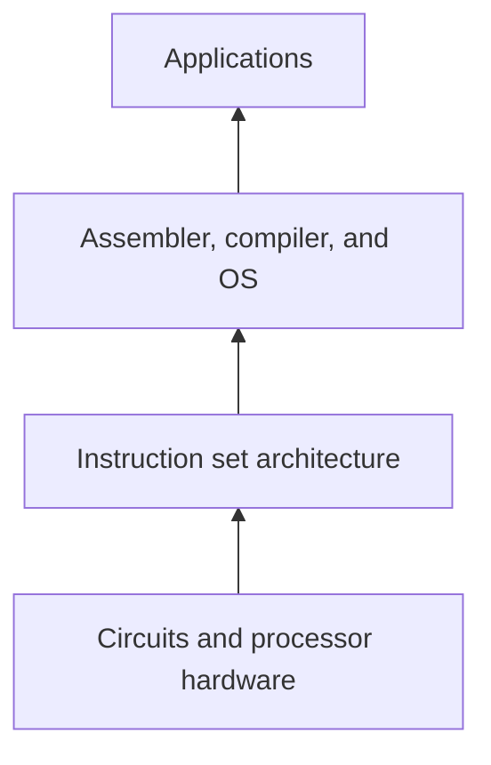

# Architecture and Boot

## The software–hardware boundary

An **instruction set architecture (ISA)** specifies the instructions, registers, and behavior visible to software. Microarchitecture implements that interface. A CPU fetches instructions using its program counter, executes operations using registers and the ALU, and accesses memory and I/O.

## x86 and protection

- The 8086 has 16-bit registers and a 20-bit physical address space (1 MiB). In real mode, `physical = segment × 16 + offset`; segments may overlap.
- Real mode lacks modern memory protection. Protected mode adds privilege and protection; later x86 systems support paging and 64-bit long mode.
- A byte is 8 bits. The 8086 word is 16 bits; RISC-V calls 32 bits a word.
- Legacy BIOS boot selects a boot device and loads bootstrap code, traditionally from the disk's first sector. This is a historical path, not the only modern boot method.

## RISC-V and xv6

| Mode | Typical role |
| --- | --- |
| M (machine) | Highest privilege; platform firmware and low-level setup. |
| S (supervisor) | OS kernel, page-table and trap management. |
| U (user) | Applications with restricted privilege. |

The unprivileged ISA defines ordinary instructions; the privileged architecture supplies modes, traps, control/status registers, and memory management for an OS. A **hart** is a hardware execution context, with its own architectural state; multiple harts can execute concurrently.

Typical boot sequence, with platform-specific details:

Firmware initializes hardware and may offer the Supervisor Binary Interface (SBI). The loader places the kernel in memory; early kernel code sets up stacks, memory translation, and traps before starting userspace. A particular platform can combine or omit stages.

## RISC-V control and status registers

| Register | Purpose |
| --- | --- |
| `mtvec` / `stvec` | Trap handler entry configuration for machine / supervisor mode. |
| `mepc` / `sepc` | Saved program counter used for return from a machine / supervisor trap. |
| `mstatus` | Privilege and interrupt state, including the previous-privilege field `MPP`. |
| `sie` | Enables selected supervisor interrupt sources. |
| `satp` | Controls address translation and identifies the root page table. |

In the course's M-to-S startup example: prepare the stack, write the kernel entry address to `mepc`, set `mstatus.MPP` to supervisor mode, then execute `mret`. The instruction transfers control to `mepc` in S-mode. Other initialization and delegation depend on the platform.

> [!question] Check yourself
> Explain why an ISA needs privileged operations in addition to ordinary arithmetic and load/store instructions.

**Course sources:** Professor Slides 1-2-ISA and 2-1-Hart; [[Class Week 1 - Day 2]], [[Class Week 2 - Day 1]]; submitted Assignment 1.
