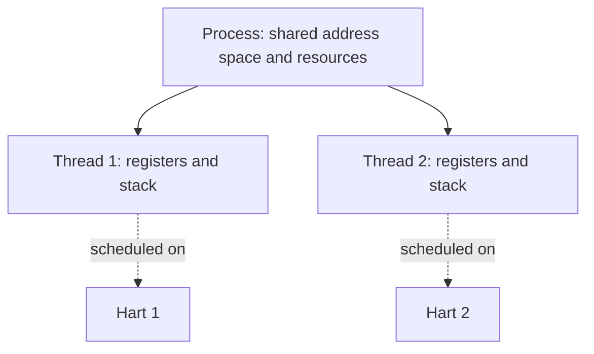

# Processes, Threads, and Memory

## Process, thread, and hart

| Term | What it represents |
| --- | --- |
| Program | Executable instructions stored on disk. |
| Process | Running program with an address space and OS-managed resources. |
| Thread | An execution stream with its own registers, program counter, and stack. |
| Hart | Hardware execution context on which a thread can run. |

Threads of one process share its code, data, heap, and open resources, but have separate execution contexts and stacks. Different processes normally have separate virtual address spaces. The scheduler maps runnable threads or processes to available harts over time.



## Virtual memory and paging

A process uses **virtual addresses**. Hardware consults page tables to translate a virtual page to a physical frame and checks access permissions. Pages provide isolation and allow noncontiguous physical allocation. A page fault occurs when an access cannot currently be completed under the mapping or permissions; the kernel decides whether it can resolve it.

```text
virtual address = virtual page number | offset
page table maps virtual page → physical frame
physical address = physical frame | same offset
```

The root page-table pointer identifies the active translation hierarchy. The operating system creates and maintains mappings; a context switch between processes may require changing the active page table.

## Stack and heap

| Region | Typical use | Lifetime |
| --- | --- | --- |
| Code | Program instructions | While mapped |
| Data | Global and static variables | Process lifetime |
| Heap | Dynamically allocated objects | Until freed or process exits |
| Stack | Function calls, local state, return information | Usually until function returns |

A pointer stores an address; dereferencing it accesses the pointed-to object. A pointer to a local variable cannot safely outlive that variable. Address-space diagrams are conceptual; exact placement and growth directions depend on platform and implementation.

## OS records

A **PCB** records process state, identity, memory mappings, and resources. A **TCB** records per-thread state such as saved registers, stack, and scheduling state. Implementations may combine or distribute these structures. The saved context permits resuming work after a switch.

> [!question] Check yourself
> Two threads modify the same global counter. Which state do they share, and which state is private to each?

**Course sources:** Professor Slides 2-1-Hart; Professor Notes Lecture2-2; [[Class Week 2 - Day 1]], [[Class Week 2 - Day 2]].
