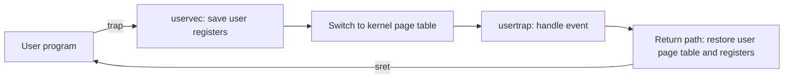

# Process Creation and xv6

## `fork`, `exec`, `wait`, and `exit`

| Call | Purpose | Key result |
| --- | --- | --- |
| `fork()` | Create a child process from the calling process. | Returns child PID to parent, `0` to child, negative on failure. |
| `exec(...)` | Replace the current process image with a new program. | On success the old program does not resume; PID normally stays the same. |
| `wait(...)` | Collect a terminated child's status. | May block if eligible children exist but none have exited. |
| `exit(...)` | Terminate the calling process. | Exit status remains available until collected. |

After `fork`, parent and child continue independently from the return point. Their order is not guaranteed. The child's address space starts with the parent's contents, but later ordinary private writes are independent. File descriptors can refer to shared underlying open files.

```c
int pid = fork();
if (pid < 0) {
    // creation failed
} else if (pid == 0) {
    // child: exec a program; if exec returns, it failed
} else {
    // parent: wait for a child, if desired
}
```

An **orphan** has outlived its parent and is adopted by an appropriate system process. A **zombie** has exited but still has status information awaiting collection. Calling `wait` reaps a terminated child; it need not sleep if a child has already exited. A parent with several children may wait repeatedly. In a multithreaded POSIX process, the child of `fork` contains only the calling thread; shared state may need special care.

## xv6 kernel image

In the course's xv6 layout, source files compile to object files and are linked using a linker script into a kernel image. The script sets section placement and entry; early `entry.S` establishes a stack and transfers to startup code. User programs are built separately and placed in the filesystem image. See [[Homework 2]] for the build and address layout rather than assuming that every xv6 version has identical paths.

## User trap and trampoline

The CPU enters supervisor mode on a trap, but initially still uses the user page table. In the course's RISC-V xv6, trampoline code is mapped at the same virtual address in both user and kernel page tables so instruction execution can continue during the switch.



The **trapframe** preserves user register state for returning to user mode. A scheduler **context** stores kernel execution state for `swtch`; these are related but different saves. A system call can return to the same process without a scheduling switch. A blocking call or timer can lead to one; see [[05 - Scheduling Mechanics]].

**Course sources:** Professor Slides Lecture3-1-process-fork; Professor Notes Lecture2-2, Lecture3-1, Lecture3-2; [[Class Week 3 - Day 1]], [[Class Week 3 - Day 2]], [[Homework 2]], submitted Assignments 1–3.
