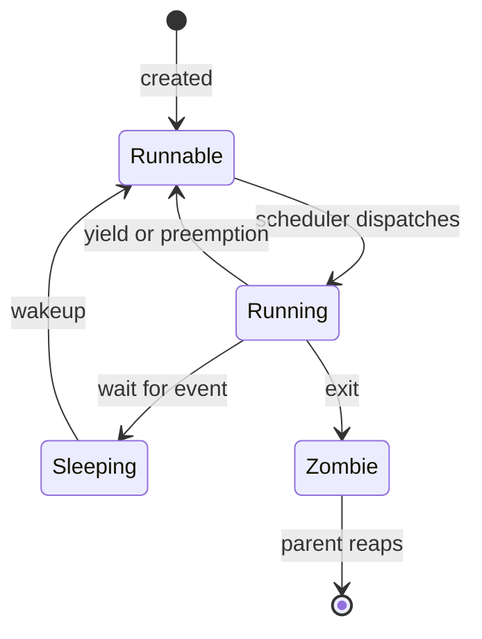

# Scheduling Mechanics

A scheduling **policy** decides who runs; the **mechanism** saves and restores execution state to make the decision happen. Preemption lets the OS take the CPU from running work, often after a timer interrupt. Non-preemptive work continues until it blocks, exits, or voluntarily yields.

## Process states



Runnable means eligible for CPU time, not currently executing. Sleeping means waiting for an event and cannot run until awakened. An I/O request can block, but does not necessarily do so if it can complete immediately.

## xv6 scheduling functions

| Function | Role |
| --- | --- |
| `scheduler()` | Per-hart loop that finds runnable work, marks it running, and switches to it. |
| `swtch()` | Save one kernel context and restore another. |
| `sched()` | Switch from the current process's kernel context to the scheduler after a state change. |
| `yield()` | Make current process runnable and give up the CPU. |
| Sleep function, with channel and lock arguments | Atomically arrange a wait on a channel and yield; exact locking matters. |
| `wakeup(chan)` | Mark processes waiting on the channel runnable; it does not immediately run them. |

A switch has overhead: saved/restored registers, scheduler work, and potentially lost cache locality. Switching between processes can also change memory translation. xv6's basic scheduler cycles through runnable processes; examine the assigned version for exact details.

### Timer interrupt example

```text
P1 user code → timer → uservec saves user state → usertrap → yield
→ P1 RUNNABLE → sched → swtch → scheduler → select P2 RUNNING
→ swtch to P2 kernel context → return-to-user path → P2 user code
```

The scheduler could select P1 again. A process resumes its saved kernel execution before eventually returning to user mode. The interrupt is the event; the context switch is the later transfer of execution.

## Metrics

For arrival `a`, first start `s`, completion `c`, and total CPU service `b`:

| Metric | Calculation | Interpretation |
| --- | --- | --- |
| Turnaround | `c − a` | Arrival to completion. |
| Response | `s − a` | Arrival to first CPU service. |
| Ready waiting | Sum of all time in ready state | Excludes running and blocked time. |
| Throughput | Completed jobs / elapsed time | Work completed per unit time. |

For a single CPU burst with no I/O or other blocking, `waiting = turnaround − burst`. With I/O, subtract blocked time too. See [[06 - Scheduling Policies and Examples]].

**Course sources:** Professor Slides 3-2-scheduling-theory1 and Lecture4-1-scheduling-theory1; Professor Notes Lecture3-2; submitted Assignment 3; [[Class Week 3 - Day 2]], [[Class Week 4 - Day 1]].
