# Scheduling Policies and Examples

## Compare the policies

| Policy | Choice | Preemptive? | Tradeoff |
| --- | --- | --- | --- |
| FCFS / FIFO | Earliest ready arrival | No | Simple; long jobs can delay short jobs (convoy effect). |
| SJF | Shortest estimated next burst among ready jobs | No | Favors short jobs; burst must be estimated, long jobs may starve. |
| SRTF | Smallest remaining time | Yes | A shorter arrival can preempt; needs remaining-time estimates. |
| HRRN | Highest `(waiting + service) / service` | Usually no | Waiting increases priority, balancing age and short service. |
| Round Robin | FIFO turns of up to quantum `q` | Yes | Responsive; small `q` increases switching overhead, large `q` approaches FCFS. |
| Priority | Highest priority | Either | Lower-priority work can starve; aging can help. |
| MLFQ | Highest nonempty queue, often RR within a level | Usually yes | Learns from past behavior rather than knowing future bursts. |
| EDF | Earliest real deadline | Usually yes | Used for deadline-driven workloads. |

A new arrival only competes after its arrival. State tie-breaking and quantum-boundary rules before solving a problem.

## Worked workload: Assignment 4

One CPU; no I/O or switching cost; P1 `(arrival 0, burst 8)`, P2 `(1, 4)`, P3 `(2, 2)`, times in ms. RR has `q = 2`, with arrivals queued before the expired process at a boundary.

```text
FCFS   0 | P1 | 8 | P2 | 12 | P3 | 14
SJF    0 | P1 | 8 | P3 | 10 | P2 | 14
SRTF   0 | P1 | 1 | P2 | 2 | P3 | 4 | P2 | 7 | P1 | 14
RR     0 | P1 | 2 | P2 | 4 | P3 | 6 | P1 | 8 | P2 | 10 | P1 | 14
```

```mermaid
gantt
    title SRTF execution - milliseconds
    dateFormat x
    axisFormat %L
    tickInterval 2millisecond
    todayMarker off
    section CPU
    P1 :a, 0, 1ms
    P2 :b, 1, 1ms
    P3 :c, 2, 2ms
    P2 :d, 4, 3ms
    P1 :e, 7, 7ms
```



At `t=1`, P1 has 7 left, so P2's 4 preempts it. At `t=2`, P2 has 3 left, so P3's 2 preempts it. The chart's `002` means 2 ms.

| Policy | Average turnaround | Average waiting | Average response |
| --- | ---: | ---: | ---: |
| FCFS | 10.33 | 5.67 | 5.67 |
| SJF | 9.67 | 5.00 | 5.00 |
| SRTF | 7.33 | 2.67 | 0.00 |
| RR | 9.00 | 4.33 | 1.00 |

For SRTF P2: `completion 7 − arrival 1 = turnaround 6`; `waiting 6 − burst 4 = 2`; `response 1 − 1 = 0`. Every timeline must execute 14 ms of total work. Full queue-by-queue solutions and other charts: [[Homework 4]].

## MLFQ and gaming

New jobs typically start high; the highest nonempty queue runs first. CPU-intensive jobs consume an allotment and move down; periodic boosts can prevent starvation. Interactive jobs often block before using much CPU. A **quantum** is one turn; an **allotment** is the total allowed at a priority level, potentially across turns.

For Q0 allotment 4 ms, Q1 allotment 8 ms, and job A needing 13 ms: A uses 4 in Q0, 8 in Q1, and 1 in Q2. If B arrives in higher-priority Q0 while A has 1 ms left in Q2, MLFQ selects B; SRTF selects A if B needs more than 1 ms.

> [!warning] Gaming the scheduler
> If usage resets on every yield, a CPU-bound task can repeatedly yield just before its allotment ends. Count cumulative CPU time at the level across yields and blocking.

## Weighted fairness and deadlines

**CFS lecture model:** choose the runnable task with the least virtual runtime. Ideal share is `weight / sum of runnable weights`. For actual CPU time `Δt`, `Δvruntime = Δt × 1024 / weight`. With weights 1024 and 2048, ideal shares are 1/3 and 2/3; after each runs 6 ms, virtual runtime increases by 6 and 3 respectively. A larger weight accumulates virtual runtime more slowly. Linux nice values influence weight: lower nice means higher weight.

**EEVDF:** conceptually, `lag = ideal service − actual service`. First select tasks with nonnegative lag, then choose the earliest virtual deadline. In the assignment's normalization, a request's deadline is `starting vruntime + slice × 1024 / weight`. A shorter slice helps responsiveness but does not guarantee the earliest deadline if starting virtual runtimes differ.

**EDF:** choose the earliest actual deadline among ready jobs. Example: A `(4 ms, deadline 12)`, B `(3, 7)`, C `(5, 15)` all arrive at 0: B runs 0–3, A 3–7, C 7–12; all meet their deadlines. EDF's deadline is an actual completion constraint; EEVDF's virtual deadline orders eligible service requests. EDF's single-processor optimality assumes independent preemptible jobs and no preemption cost.

**Course sources:** Professor Slides Lecture4-1-scheduling-theory1 and 3-2-scheduling-theory1; Professor Notes Lecture4-1 and Lecture4-2; [[Class Week 4 - Day 1]], [[Class Week 4 - Day 2]], [[Class Week 5 - Day 1]], [[Homework 4]], submitted Assignment 4. **Additional reference:** [Linux EEVDF documentation](https://docs.kernel.org/scheduler/sched-eevdf.html) for eligibility and virtual deadlines.
