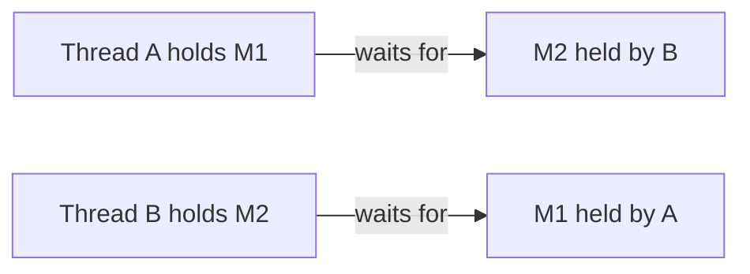

# Semaphores and Coordination

A **semaphore** tracks permits and provides atomic `wait` (P) and `signal` (V) operations. `wait` takes a permit or waits; `signal` provides a permit or wakes a waiter. A counting semaphore models multiple available resources; a binary semaphore represents at most one permit. Unlike a typical mutex, a semaphore does not inherently require the signaling thread to be the one that waited.

## Enforce an order

Initialize `done = 0`:

```text
Thread A                      Thread B
statement 1                   wait(done)
signal(done)                  statement 2
```

B cannot execute statement 2 until A signals. This orders events; it does not require both threads to access the same critical section.

## A blocking implementation model

The professor's model stores a count and waiting queue. The following operations, including queueing and blocking, must be coordinated atomically; they are conceptual pseudocode.

```text
wait(s):                      signal(s):
    s.count -= 1                  s.count += 1
    if s.count < 0:               if s.count <= 0:
        enqueue current               wake one queued waiter
        block current
```

In this particular implementation a negative count's magnitude represents the number of waiting participants; other implementations may represent waiting differently. Waking makes a participant runnable, not necessarily immediately running.

Example, initially `m = 1`: A waits → 0 and enters; B waits → -1 and blocks; C waits → -2 and blocks. A signals → -1 and wakes one; the next signal → 0 wakes the other; the final signal → 1 makes the permit available. This assumes the shown queue and handoff behavior.

## Bounded producer–consumer buffer

For a circular buffer of `N` slots, initialize `space = N`, `items = 0`, `mutex = 1`.

```text
Producer                              Consumer
wait(space)                           wait(items)
wait(mutex)                           wait(mutex)
put item at buffer[in]                take item from buffer[out]
in = (in + 1) % N                     out = (out + 1) % N
signal(mutex)                         signal(mutex)
signal(items)                         signal(space)
```

- `space` prevents insertion into a full buffer; `items` prevents removal from an empty buffer.
- `mutex` protects buffer and index updates. The modulo wraps each index.
- Wait for the relevant resource **before** taking the mutex: otherwise a consumer can sleep holding the mutex while the producer needs it to create an item.
- These operations are conceptual; use the relevant system's synchronization APIs in actual code.

## Lock ordering and deadlock



A consistent global acquisition order, such as M1 then M2 for every thread, prevents this circular wait. Release in reverse order as a clear convention. A nonrecursive mutex can also self-deadlock if its owner tries to lock it again, including indirectly through a called function. Pair acquisitions and releases on every control path.

> [!question] Check yourself
> If `items` starts at 0 and the consumer runs first, where does it wait? What changes when the producer inserts an item?

**Course sources:** Professor Notes Lecture7-1; [[Class Week 7 - Day 1]]; Professor Slides Lecture5-1-1process-relation-overall.
